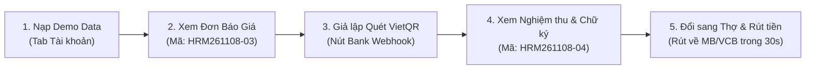

# DÀN Ý BÁO CÁO & THUYẾT TRÌNH ĐỒ ÁN TỐT NGHIỆP
# HỆ THỐNG DỊCH VỤ SỬA CHỮA & BẢO TRÌ ĐIỆN GIA DỤNG HRMSS (MOBILE APP)

> **Tài liệu chuẩn bị thuyết trình & phản biện trước Hội đồng Giảng viên**  
> *Đề tài: Xây dựng Ứng dụng Di động Quản lý Dịch vụ Kỹ thuật & Sửa chữa Thiết bị Gia dụng Tại nhà*

---

## 🎯 PHẦN 1: ĐẶT VẤN ĐỀ & SỰ KHÁC BIỆT CỐT LÕI (USP)

### 1. Thực trạng thị trường hiện nay:
- **Thợ tự do truyền thống:** Giá cả không minh bạch, hay "vẽ bệnh" đòi thêm tiền tại chỗ, không có bảo hành hoặc thợ "mất hút" sau khi lấy tiền.
- **Nền tảng trung gian tự do (kiểu Grab/Gojek):** Coi thợ là đối tác độc lập, cho phép bật/tắt trực tuyến để tranh cướp đơn, nền tảng chỉ ăn hoa hồng mà không chịu trách nhiệm chất lượng sửa chữa.

### 2. Mô hình đề xuất của Đồ án: Doanh nghiệp Quản lý Tập trung (Managed Marketplace / HRMSS):
- **Công ty đứng ra bảo lãnh 100% chất lượng:** Kích hoạt Phiếu Bảo Hành Điện Tử từ 30 đến 90 ngày cho mọi đơn hàng.
- **Minh bạch chi phí tuyệt đối:** Giá niêm yết trên app; mọi chi phí phát sinh thực tế tại nhà **bắt buộc phải được khách hàng phê duyệt trên app** mới được phép thi công.
- **Dòng tiền khép kín (Escrow Model):** Khách hàng quét mã VietQR chuyển khoản vào tài khoản Công ty (MBBank), hệ thống tự động đối soát và giải ngân thu nhập + hoàn ứng vật tư vào Ví Thợ.

---

## 🏗️ PHẦN 2: 6 TRỤC TÍNH NĂNG MAPPING ĐỒNG BỘ TOÀN HỆ THỐNG

| Trục chức năng | Phía Khách hàng (Client App) | Phía Kỹ thuật viên (Tech App) | Hệ thống Trung tâm (Backend / Admin) |
| :--- | :--- | :--- | :--- |
| **1. Điều phối thông minh** | Đặt lịch theo thiết bị, khung giờ, chọn linh kiện | Nhận việc theo còi, xem khoảng cách, từ chối có lý do | Thuật toán Weighted Dispatching (Khoảng cách 40%, Kỹ năng 30%, Uy tín 20%, Cân bằng 10%) |
| **2. Định vị & Check-in** | Xem vị trí thợ di chuyển trực tiếp (Live Tracking) | Bật GPS, Check-in hiện trường | Kiểm tra Geofence bán kính < 100m, chống đến muộn |
| **3. Báo giá & Phát sinh** | Nhận thẻ đối chiếu giá cũ/mới, duyệt hoặc yêu cầu sửa lại | Form thêm công/vật tư phát sinh + Chụp ảnh hư hỏng | Lưu trữ lịch sử đàm phán báo giá (Audit Trail) |
| **4. Dòng tiền & Ví Thợ** | Quét mã VietQR chuyển khoản vào TK Công ty (MBBank) | Xem thu nhập chi tiết, hoàn ứng 100% VT, rút tiền ATM | Webhook gạch nợ tự động & Phân bổ ví thợ tức thì |
| **5. Nghiệm thu & Chữ ký số** | Xem biên bản, ký tên xác nhận nghiệm thu trên màn hình | Checklist 4 bước an toàn, chụp ảnh sau khi làm | Lưu trữ biên bản kỹ thuật số chống tranh chấp |
| **6. Bảo hành điện tử** | Sổ bảo hành điện tử 60 ngày kèm mã QR trên app | Nhận phân công ưu tiên cho đơn bảo hành cũ | Quản lý vòng đời thiết bị & lịch bảo dưỡng định kỳ |

---

## 🎬 PHẦN 3: KỊCH BẢN DEMO THỰC CHIẾN 5 BƯỚC (DÀNH CHO BUỔI REVIEW)

1. **Bước 1: Nạp kịch bản mẫu**
   - Mở app $\rightarrow$ Tab Tài khoản $\rightarrow$ Bấm nút **`[ 🎬 Nạp kịch bản Demo ]`** (Hệ thống nạp 4 đơn hàng thực tế đầy đủ các trạng thái).
2. **Bước 2: Trình diễn Báo giá phát sinh & Đối chiếu**
   - Mở đơn **`HRM261108-03`** (trạng thái `quoted`).
   - Chỉ cho hội đồng thấy: Giá gốc đã đặt (150k) + Khoản phát sinh thêm (280k sò lạnh + 50k gia cố quạt có nhãn `[Phát sinh]`).
   - Mở sheet **`Báo giá lại / Hủy`** để chứng minh khách có quyền thương lượng lại phương án rẻ hơn hoặc hủy có chính sách.
3. **Bước 3: Trình diễn Thanh toán VietQR & Webhook tự động**
   - Mở thẻ VietQR hiển thị đầy đủ: *CTY CP CÔNG NGHỆ HRMSS - MBBank - STK 0908 888 999 - Cú pháp mã đơn*.
   - Bấm nút **`[ ⚡ Giả lập Quét QR thành công (Bank Webhook) ]`** $\rightarrow$ Hệ thống nổ chuông, tự động chuyển đơn sang `ĐÃ THANH TOÁN` trong 1 giây!
4. **Bước 4: Trình diễn Nghiệm thu kỹ thuật số & Chữ ký khách hàng**
   - Mở đơn **`HRM261108-04`** (trạng thái `done`).
   - Cho hội đồng xem: Checklist 4 tiêu chuẩn an toàn điện lạnh, ảnh trước/sau và **Chữ ký điện tử của khách hàng** `Nguyễn Văn Minh`.
5. **Bước 5: Chuyển sang Thợ & Trình diễn Ví Thợ rút tiền ATM**
   - Chuyển sang vai trò Thợ $\rightarrow$ Vào tab Tài khoản $\rightarrow$ Mở **Ví thu nhập**.
   - Chỉ ra công thức minh bạch: Thợ hưởng 70% tiền công + 15% hoa hồng vật tư kho + **100% hoàn tiền linh kiện phát sinh mua ngoài**.
   - Bấm **`[ 💳 Rút tiền về tài khoản ngân hàng ]`** $\rightarrow$ Nhập số tiền, chọn ngân hàng $\rightarrow$ Xác nhận tiền trừ khỏi ví ngay lập tức.

---

## 💡 PHẦN 4: BỘ CÂU HỎI PHẢN BIỆN "HÓC BÚA" VÀ CÁCH TRẢ LỜI 10 ĐIỂM

### Câu 1: Tại sao không để khách chuyển khoản trực tiếp cho thợ cho nhanh mà phải qua tài khoản Công ty?
> **Trả lời:**  
> *"Dạ thưa thầy/cô, nếu để tiền vào tài khoản cá nhân của thợ thì hệ thống sẽ gặp 3 rủi ro rất lớn:  
> 1. **Khách hàng mất quyền lợi:** Nếu thiết bị hỏng lại mà thợ đã nghỉ việc hoặc chặn số, khách hàng sẽ mất trắng vì công ty không cầm tiền bảo lãnh.  
> 2. **Thất thoát doanh thu:** Công ty không kiểm soát được thợ có báo đúng số tiền không hay 'đi đêm' với khách.  
> 3. **Tranh chấp pháp lý:** Công ty đứng ra xuất hóa đơn và cam kết bảo hành 60 ngày thì dòng tiền bắt buộc phải về tài khoản pháp nhân Công ty (MBBank) thông qua VietQR có mã đơn. Sau đó hệ thống tự động đối soát và giải ngân thu nhập về Ví của thợ trong tích tắc."*

### Câu 2: Nếu thợ đến tận nhà tháo máy kiểm tra rồi nhưng khách không đồng ý báo giá phát sinh thì giải quyết thế nào?
> **Trả lời:**  
> *"Dạ thưa thầy/cô, hệ thống của em giải quyết văn minh theo 2 trường hợp:  
> - **Nếu báo giá từ xa trước khi thợ đi:** Khách từ chối thì hủy miễn phí 100% (0đ).  
> - **Nếu thợ đã đến tận nhà, check-in GPS và đo đạc kiểm tra thiết bị:** Nếu khách không đồng ý sửa tiếp, khách chỉ thanh toán một khoản **Phí kiểm tra tại nhà 100.000đ** (đã được quy định rõ trong điều khoản khi đặt). Khoản này được trả cho thợ để bù đắp chi phí xăng xe và công sức chuyên môn, tránh tình trạng khách gọi thợ đến kiểm tra miễn phí rồi tự sửa."*

### Câu 3: Thợ bỏ tiền túi mua linh kiện ngoài thì có sợ bị công ty chiếm dụng vốn lâu không?
> **Trả lời:**  
> *"Dạ hoàn toàn không, vì hệ thống áp dụng cơ chế **Hoàn ứng tự động qua Ví (Instant Reimbursement)**. Khi thợ nhập vật tư ngoài kèm ảnh hóa đơn mua hàng và được khách duyệt, ngay khi khách thanh toán đơn, hệ thống tự động hoàn 100% tiền vật tư vào Ví Thợ trên App. Thợ chỉ cần bấm nút 'Rút tiền' là tiền về tài khoản ATM cá nhân trong 30 giây mà không cần phải mang hóa đơn giấy về công ty chờ kế toán duyệt cuối tháng."*

### Câu 4: Làm sao ngăn chặn tình trạng thợ ngồi ở nhà bấm 'Đã đến nơi' để tính phí hoặc gian lận?
> **Trả lời:**  
> *"Hệ thống tích hợp tính năng **GPS Geofencing**. Khi thợ bấm nút 'Check-in GPS', app sẽ lấy tọa độ thực tế của thợ và so sánh với tọa độ địa chỉ nhà khách hàng. Khoảng cách bắt buộc phải **nhỏ hơn 100 mét** thì hệ thống mới cho phép check-in và bắt đầu giai đoạn chẩn đoán. Ngoài ra, app còn có tính năng quét mã QR của chủ nhà để nhận diện đúng khách và cộng điểm uy tín cho thợ."*
