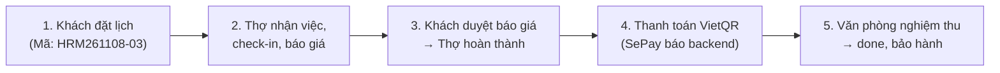

# DÀN Ý BÁO CÁO & THUYẾT TRÌNH ĐỒ ÁN TỐT NGHIỆP
# HỆ THỐNG DỊCH VỤ SỬA CHỮA & BẢO TRÌ ĐIỆN GIA DỤNG HRMSS — APP "THỢ MINH ĐỨC"

> **Tài liệu chuẩn bị thuyết trình & phản biện trước Hội đồng Giảng viên**  
> *Đề tài: Xây dựng Ứng dụng Di động Quản lý Dịch vụ Kỹ thuật & Sửa chữa Thiết bị Gia dụng Tại nhà*

> [!NOTE]
> **Ghi chú thống nhất (cập nhật 11/2026)**
> - Tên gọi: **"Thợ Minh Đức"** là tên app; **HRMSS** là tên hệ thống/công ty — *CTY CP CÔNG NGHỆ & DỊCH VỤ HRMSS*. Địa bàn ví dụ: Hà Nội (Cầu Giấy). Mã đơn tiền tố `HRM` (ví dụ `HRM261108-03`).
> - Trọng số điều phối: **Workload 0.40 / Distance 0.35 / Rating 0.25**; ngưỡng top candidate **0.88**; chọn ngẫu nhiên trong top ≤ 3; **gán trực tiếp** (không có chợ việc/giật đơn).
> - Geofence check-in **≤ 200 m**. Bảo hành theo hạng **60/75/90/120 ngày** (Thành viên/Bạc/Vàng/Kim cương, tối thiểu 60).
> - Chia tiền: thợ hưởng **70% tiền công + 15% hoa hồng vật tư kho**; vật tư mua ngoài **hoàn 100%**; thu tiền mặt thì công ty khấu trừ **30% tiền công** từ ví ký quỹ. Hoàn ứng khi đơn được thanh toán đủ.
> - Luồng kết thúc đơn: hoàn thành → thanh toán (VietQR/tiền mặt) → Văn phòng nghiệm thu → `done` (trong app: `pending_payment` → `pending_review` → `done`).
> - Các câu "nói quá" ở bản cũ (webhook giả lập 1 giây, rút tiền ATM 30 giây, bảo hành 30–90 ngày, geofence 100 m, trọng số 40/30/20/10) đã được viết lại; mỗi tính năng ghi rõ **đã có** hay **hướng phát triển**.

---

## 🎯 PHẦN 1: ĐẶT VẤN ĐỀ & SỰ KHÁC BIỆT CỐT LÕI (USP)

### 1. Thực trạng thị trường hiện nay:
- **Thợ tự do truyền thống:** Giá cả không minh bạch, hay "vẽ bệnh" đòi thêm tiền tại chỗ, không có bảo hành hoặc thợ "mất hút" sau khi lấy tiền.
- **Nền tảng trung gian tự do (kiểu Grab/Gojek):** Coi thợ là đối tác độc lập, cho phép bật/tắt trực tuyến để tranh cướp đơn, nền tảng chỉ ăn hoa hồng mà không chịu trách nhiệm chất lượng sửa chữa.

### 2. Mô hình đề xuất của Đồ án: Doanh nghiệp Quản lý Tập trung (Managed Marketplace / HRMSS):
- **Công ty đứng ra bảo lãnh chất lượng:** Phiếu bảo hành điện tử cho mọi đơn hoàn tất, thời hạn theo hạng thành viên **60 / 75 / 90 / 120 ngày** (Thành viên / Bạc / Vàng / Kim cương).
- **Minh bạch chi phí:** Giá niêm yết trên app; mọi chi phí phát sinh tại nhà **phải được khách hàng phê duyệt trên app** mới được thi công.
- **Dòng tiền về tài khoản công ty:** Khách thanh toán tiền mặt hoặc chuyển khoản **VietQR** vào tài khoản công ty. Mã QR do backend tạo, tiền về được SePay báo cho backend để gạch nợ hoá đơn. Thu nhập của thợ do văn phòng đối soát (ví thợ tự động là hướng phát triển — xem Phần 2).

---

## 🏗️ PHẦN 2: 6 TRỤC TÍNH NĂNG MAPPING ĐỒNG BỘ TOÀN HỆ THỐNG

| Trục chức năng | Phía Khách hàng | Phía Kỹ thuật viên | Hệ thống Trung tâm (Backend / Admin) |
| :--- | :--- | :--- | :--- |
| **1. Điều phối thông minh** | Đặt lịch theo thiết bị, khung giờ, chọn linh kiện | Nhận việc được gán, xem khoảng cách, từ chối có lý do | Thuật toán Weighted Dispatching: **Workload 0.40, Distance 0.35, Rating 0.25**; ứng viên ≥ 0.88 × điểm cao nhất, chọn ngẫu nhiên trong top ≤ 3; gán trực tiếp |
| **2. Định vị & Check-in** | Xem vị trí thợ khi thợ đang di chuyển (app cập nhật **15 giây/lần**) | Bật GPS (chỉ khi đang dùng app), check-in tại nhà khách | Kiểm tra Geofence bán kính **≤ 200 m** |
| **3. Báo giá & Phát sinh** | Xem đối chiếu giá cũ/mới, duyệt hoặc từ chối | Form thêm công/vật tư phát sinh + chụp ảnh hư hỏng | Lưu lịch sử báo giá |
| **4. Thanh toán** | Tiền mặt hoặc **VietQR** (mã do backend tạo, ảnh `img.vietqr.io`) | Xác nhận thu tiền mặt | SePay webhook báo tiền về → backend gạch nợ hoá đơn; app kiểm tra hoá đơn **mỗi 5 giây** |
| **5. Nghiệm thu & Chữ ký** | Xem biên bản, ký xác nhận trên màn hình | Checklist an toàn, ảnh trước/sau | Văn phòng nghiệm thu (`pending_review` → `done`), lưu biên bản |
| **6. Bảo hành điện tử** | Sổ bảo hành theo hạng (60–120 ngày), tra cứu theo SĐT/mã đơn | Nhận đơn bảo hành liên kết đơn gốc | Quản lý vòng đời thiết bị & lịch bảo dưỡng |

**Đã có trong app (kết nối backend thật HRMSS API):** đặt lịch, gán thợ, nhận/từ chối việc, check-in, chẩn đoán, báo giá & duyệt, tiến độ, hoàn thành, thanh toán VietQR/tiền mặt, nghiệm thu, đánh giá, điểm & hạng, bảo hành.

**Hướng phát triển:** WebSocket (Socket.IO) cho cập nhật tức thời — hiện app đồng bộ khi thao tác, khi quay lại app và polling định kỳ; push notification; **ví thợ & rút tiền tự động** (backend chưa có bảng ví — hiện văn phòng đối soát ngoài app).

---

## 🎬 PHẦN 3: KỊCH BẢN DEMO 5 BƯỚC (DÀNH CHO BUỔI REVIEW)

1. **Bước 1: Khách đặt lịch** — mở app với tài khoản Khách (tab 1), đặt dịch vụ điện lạnh tại Cầu Giấy, Hà Nội. Hệ thống tạo đơn mã dạng `HRM261108-03` và gán thợ.
2. **Bước 2: Thợ xử lý** — tab 2 đăng nhập tài khoản Thợ: nhận việc → đang đến (chia sẻ vị trí 15 giây/lần) → check-in (≤ 200 m) → chẩn đoán → báo giá phát sinh (ví dụ: giá gốc 150k + 280k sò lạnh + 50k gia cố quạt, có nhãn `[Phát sinh]`).
3. **Bước 3: Khách duyệt báo giá** — chỉ cho hội đồng thấy khách có quyền duyệt hoặc từ chối; thợ cập nhật tiến độ và hoàn thành.
4. **Bước 4: Thanh toán VietQR** — màn thanh toán hiển thị mã QR do backend tạo: đúng số tiền còn phải trả, nội dung chuyển khoản `HRMSS<số>`, tài khoản nhận *CTY CP CÔNG NGHỆ & DỊCH VỤ HRMSS – MBBank – STK 0908 888 999 (ví dụ minh hoạ)*. Khi tiền về, SePay gọi webhook cho backend; app hỏi lại hoá đơn mỗi 5 giây và tự chuyển trạng thái khi đã đủ tiền (chuyển thiếu thì tạo mã mới cho phần còn lại).
5. **Bước 5: Nghiệm thu & bảo hành** — đơn sang `pending_review`, văn phòng nghiệm thu → `done`; khách xem biên bản (checklist, ảnh trước/sau, chữ ký), phiếu bảo hành theo hạng, được cộng điểm và đánh giá thợ.

---

## 💡 PHẦN 4: BỘ CÂU HỎI PHẢN BIỆN VÀ CÁCH TRẢ LỜI

### Câu 1: Tại sao không để khách chuyển khoản trực tiếp cho thợ cho nhanh mà phải qua tài khoản Công ty?
> **Trả lời:**  
> *"Dạ thưa thầy/cô, nếu để tiền vào tài khoản cá nhân của thợ thì hệ thống gặp 3 rủi ro:  
> 1. **Khách hàng mất quyền lợi:** Nếu thiết bị hỏng lại mà thợ đã nghỉ việc, công ty không cầm tiền để bảo lãnh.  
> 2. **Thất thoát doanh thu:** Công ty không kiểm soát được thợ báo đúng số tiền hay không.  
> 3. **Pháp lý:** Công ty xuất hoá đơn và cam kết bảo hành (tối thiểu 60 ngày, theo hạng tới 120 ngày) nên dòng tiền phải về tài khoản pháp nhân qua VietQR có nội dung gắn với đơn. SePay báo cho backend khi tiền về, backend đối chiếu số tiền và gạch nợ hoá đơn. Thu nhập của thợ (70% tiền công + 15% hoa hồng vật tư kho + hoàn 100% vật tư mua ngoài) được văn phòng đối soát; ví thợ tự động là hướng phát triển."*

### Câu 2: Nếu thợ đến tận nhà tháo máy kiểm tra rồi nhưng khách không đồng ý báo giá phát sinh thì giải quyết thế nào?
> **Trả lời:**  
> *"Dạ hệ thống giải quyết theo 2 trường hợp:  
> - **Trước khi thợ tới:** Khách huỷ miễn phí khi đơn đang chờ nhận/đã nhận và còn ≥ 60 phút trước giờ hẹn.  
> - **Thợ đã check-in GPS và kiểm tra thiết bị:** Nếu khách không đồng ý sửa tiếp, khách chỉ thanh toán **Phí kiểm tra tại nhà** (quy định rõ khi đặt). Khoản này bù chi phí đi lại và công kiểm tra của thợ."*

### Câu 3: Thợ bỏ tiền túi mua linh kiện ngoài thì có sợ bị công ty chiếm dụng vốn lâu không?
> **Trả lời:**  
> *"Dạ thợ nhập vật tư mua ngoài kèm ảnh hoá đơn, khách duyệt trong báo giá. **Khi đơn được thanh toán đủ**, khoản vật tư đó được hoàn 100% cho thợ trong kỳ đối soát, không phải chờ duyệt giấy tờ cuối tháng. Hiện việc chi trả do văn phòng thực hiện; hoàn ứng tự động vào ví và rút tiền trên app là hướng phát triển."*

### Câu 4: Làm sao ngăn chặn tình trạng thợ ngồi ở nhà bấm 'Đã đến nơi' để gian lận?
> **Trả lời:**  
> *"Hệ thống dùng **GPS Geofencing**: khi thợ check-in, app lấy toạ độ thực tế của thợ (quyền vị trí chỉ khi đang dùng app) và backend so với toạ độ nhà khách. Khoảng cách phải **≤ 200 mét** mới cho check-in và bắt đầu chẩn đoán. Ngoài ra thợ có thể quét mã QR của khách tại nhà để xác thực đúng khách."*
