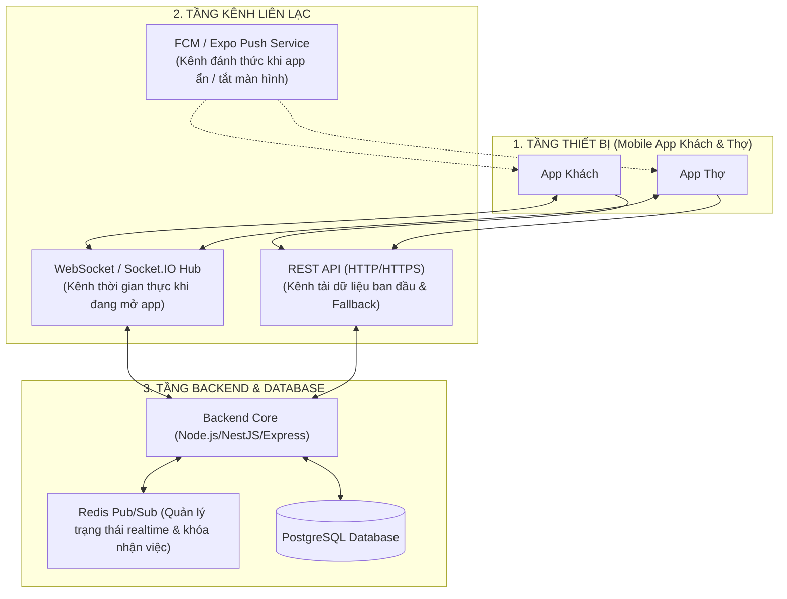

# BÁO CÁO PHÂN TÍCH TOÀN DIỆN: CÓ NÊN LÀM WEBSOCKET / REALTIME CHO HỆ THỐNG THỢ MINH ĐỨC?

> **Tài liệu chiến lược công nghệ cho Đội ngũ Backend & Mobile App**  
> Dự án: Hệ thống Điều phối Dịch vụ Kỹ thuật Tại nhà **Thợ Minh Đức**  
> Đánh giá: Ưu/nhược điểm, ma trận tính năng, so sánh công nghệ, chi phí hạ tầng và kiến trúc đề xuất.

> [!NOTE]
> **Ghi chú thống nhất (cập nhật 11/2026)**
> - **Hiện trạng app (đã có):** chưa dùng WebSocket. Dữ liệu làm mới khi thao tác + khi app quay lại foreground + **polling 30 giây**; vị trí thợ khi đang di chuyển **15 giây/lần**; hoá đơn VietQR **5 giây/lần** (tiền về được **SePay webhook** báo cho backend). WebSocket và push notification trong tài liệu này là **hướng phát triển**.
> - Mô hình **gán trực tiếp** (Workload 0.40 / Distance 0.35 / Rating 0.25, ngưỡng top 0.88, ngẫu nhiên trong top ≤ 3). Các phần **chợ việc giật đơn**, room `tech_market_<area>`, event `job:new` là **phương án cũ — KHÔNG dùng**.
> - Tên event thống nhất theo code mẫu: `order:join`, `order:leave`, `tech:send_location`, `tech:location_update`, `order:quote_decision`… Chu kỳ GPS **15 giây**, chỉ khi app đang mở (không xin vị trí nền).
> - Code mẫu đã bổ sung: CORS whitelist, kiểm tra quyền khi `order:join`/gửi vị trí, webhook xác thực chữ ký/API key + đối chiếu số tiền + idempotency.
> - Bảo hành theo hạng 60/75/90/120 ngày; địa bàn ví dụ Hà Nội (Cầu Giấy).

---

## 1. CÂU HỎI CỐT LÕI: CÓ NÊN LÀM SOCKET KHÔNG?

> **CÂU TRẢ LỜI NGẮN GỌN:**  
> **CÓ, NHƯNG THEO MÔ HÌNH LAI (HYBRID ARCHITECTURE) — KHÔNG LÀM SOCKET CHO TẤT CẢ MỌI THỨ.**  
> 
> Nếu làm Socket cho toàn bộ app (từ xem danh mục, đặt đơn đến đọc lịch sử), hệ thống sẽ bị **quá tải kết nối (Connection Leak), tốn pin điện thoại cực nhanh và rất khó debug**.  
> Ngược lại, nếu **hoàn toàn không dùng Socket** mà chỉ dùng HTTP REST thông thường, các tính năng sống còn như **Thợ di chuyển GPS trên bản đồ, Khách duyệt báo giá tại chỗ và Gạch nợ VietQR tự động** sẽ bị trễ vài giây đến vài chục giây (phụ thuộc chu kỳ polling) thay vì cập nhật tức thì.

---

## 2. MA TRẬN PHÂN TÍCH TỪNG TÍNH NĂNG: DÙNG CÔNG NGHỆ GÌ?

Không phải tính năng nào cũng cần Realtime Socket. Bảng dưới đây phân loại chính xác từng tác vụ nghiệp vụ:

| Nghiệp vụ cụ thể | Tần suất & Tính chất | WebSocket / Socket.IO | HTTP Short Polling | Push Notification (FCM/Expo) | Kết luận giải pháp tối ưu |
| :--- | :--- | :---: | :---: | :---: | :--- |
| **1. Khách đặt đơn $\rightarrow$ Hệ thống Tự Động Điều Phối (Auto-assign)** | Đơn được Backend chấm điểm & gán thẳng cho 1 Thợ tối ưu | 🟢 Nhận việc ngay khi mở app | 🔴 Không cần thiết | 🟢 **Rất quan trọng khi Thợ tắt app** (Push báo "Bạn có ca làm mới lúc 14h") | **Backend chạy thuật toán Auto-assign** $\rightarrow$ Gán thẳng đơn (`assigned`) $\rightarrow$ Bắn **Push Notification** báo thợ. Không cần chợ việc, không cần Socket tranh giành đơn. |
| **2. Thợ đang di chuyển (GPS Tracking trên bản đồ)** | Cao (app hiện cập nhật **15 giây/lần** khi thợ đang di chuyển) | 🟢 Tối ưu nhất (kết nối mở sẵn, gói tin siêu nhẹ ~100 bytes) | 🟡 Đang dùng (15s); 100 thợ x 15s ≈ 7 req/s | 🔴 Không khả thi | **WebSocket thuần / Socket.IO** (hướng phát triển) |
| **3. Thợ gửi Báo giá $\rightarrow$ Khách duyệt Đồng ý / Từ chối** | Khách & Thợ đang đứng cùng nhau tại nhà | 🟢 Cập nhật ngay trước mắt, thợ không cần reload | 🟡 Tạm chấp nhận nếu poll 5s | 🟡 Cần thiết nếu khách khóa màn hình | **Socket.IO (Room theo `request_id`)** |
| **4. Tiến độ % thi công & Tick bước quy trình** | Thỉnh thoảng (vài phút tick 1 bước) | 🟢 Phản hồi mượt | 🟢 Chấp nhận được | ⚪ Không cần thiết | **Socket.IO (Cùng room với đơn hàng)** |
| **5. Gạch nợ VietQR (SePay webhook báo về backend)** | Quan trọng sống còn về tiền tệ | 🟢 Màn hình tự nhảy tick xanh "Thành công" | 🟢 **Đang dùng: app hỏi hoá đơn mỗi 5s** | 🟢 Thông báo tiền về | **Hiện tại: SePay webhook → BE gạch nợ; app poll hoá đơn 5s.** Hướng phát triển: Webhook BE → Emit Socket |
| **6. Danh mục dịch vụ, bảng giá, chi tiết đơn cũ** | Thấp, dữ liệu đọc tĩnh | 🔴 Lãng phí kết nối | 🟢 Chuẩn RESTful HTTP cache | ⚪ Không liên quan | **REST API HTTP thông thường** |

---

## 3. SO SÁNH 4 CÔNG NGHỆ REALTIME PHỔ BIẾN

| Tiêu chí | 1. HTTP Polling (Hỏi vòng mỗi X giây) | 2. Server-Sent Events (SSE) | 3. WebSocket / Socket.IO | 4. Push Notification (FCM / Expo Push) |
| :--- | :--- | :--- | :--- | :--- |
| **Chiều truyền tin** | Client $\rightarrow$ Server (1 chiều) | Server $\rightarrow$ Client (1 chiều) | Client $\leftrightarrow$ Server (**2 chiều Full-Duplex**) | Server $\rightarrow$ Thiết bị (1 chiều) |
| **Độ trễ (Latency)** | Cao (phụ thuộc chu kỳ `setInterval`) | Thấp (~ mili-giây) | Cực thấp (~ mili-giây) | Trung bình (1 – 5 giây) |
| **Tải tài nguyên Server** | **Rất nặng** (liên tục tạo/đóng kết nối HTTP, lặp lại auth token) | Nhẹ (giữ 1 HTTP streaming) | **Rất nhẹ sau khi bắt tay (Handshake)** | Nhẹ (Google/Apple gánh hạ tầng) |
| **Hoạt động khi App tắt / Khóa màn hình** | ❌ **Chết hẳn** | ❌ **Chết hẳn** | ❌ **Bị hệ điều hành ngắt kết nối để tiết kiệm pin** |  **Hoạt động hoàn hảo** (Đánh thức app, rung chuông) |
| **Độ phức tạp triển khai** | Dễ nhất (chỉ cần `setInterval` gọi `fetch`) | Trung bình | Khá (cần quản lý Room, Disconnect, Reconnect) | Trung bình (cần đăng ký service tài khoản) |

---

## 4. RỦI RO LỚN NẾU CHỈ LÀM WEBSOCKET ĐƠN THUẦN (LỖI KINH ĐIỂN CỦA DỰ ÁN ĐỒ ÁN)

> [!WARNING]
> **RẤT NHIỀU NHÓM ĐỒ ÁN MẮC BẪY NÀY:**  
> Đội ngũ code WebSocket rất mượt khi mở 2 tab trình duyệt trên cùng 1 máy tính. Nhưng khi cài lên điện thoại thật thì:
> 1. **Thợ khóa màn hình hoặc chuyển sang Google Maps dẫn đường:** Hệ điều hành iOS/Android tự động **đóng socket sau 15–30 giây** để tiết kiệm RAM và pin. Lúc này hệ thống BE bắn đơn mới qua Socket thì Thợ **hoàn toàn không nhận được gì**!
> 2. **Khách hàng chuyển app sang ngân hàng để quét VietQR:** Socket ở App Khách bị đứt kết nối. Khi khách chuyển khoản xong quay lại app, Socket chưa kịp kết nối lại nên app vẫn hiện "Chưa thanh toán"!

👉 **Do đó, bắt buộc phải có KIẾN TRÚC LAI (HYBRID) kết hợp giữa Socket + Push Notification + Fallback Polling.**

---

## 5. KIẾN TRÚC ĐỀ XUẤT CHO HỆ THỐNG: MÔ HÌNH "3 CHÂN VẠC" (HYBRID ARCHITECTURE)

Hệ thống nên phân công rạch ròi 3 tầng công nghệ như sau:



### Nguyên lý hoạt động theo tình huống thực tế:

#### Kịch bản A: Hệ thống Tự Động Phân Công Thợ (Auto-Dispatching)
1. Khách đặt đơn $\rightarrow$ BE nhận request.
2. BE chạy thuật toán **Điều phối thông minh có trọng số (Smart Weighted Dispatching)**:
   * Lọc thợ: Đạt chuyên môn thiết bị + Không trùng slot giờ hẹn + Đang hoạt động.
   * Chấm điểm $Score = 40\% \text{Tải công việc} + 35\% \text{Khoảng cách} + 25\% \text{Đánh giá sao}$.
   * Chọn các thợ có Score ≥ 0.88 × Score cao nhất (tối đa 3), random 1 thợ $\rightarrow$ Gán thẳng đơn với trạng thái `ASSIGNED` (không qua chợ việc).
3. Thông báo cho Thợ:
   * **Bắn Push Notification (FCM/Expo)** thẳng vào máy thợ: *"Lịch mới: Vệ sinh máy lạnh lúc 14h tại Cầu Giấy"*.
   * Nếu thợ đang mở app $\rightarrow$ Socket gửi event `job:assigned` để tab "Lịch / Công việc" tự động nảy thêm ca làm mới mà thợ không cần reload. Khách hàng cũng ngay lập tức thấy thông tin thợ phụ trách (Tên, SĐT, Số sao).

#### Kịch bản B: Thợ di chuyển GPS tới nhà khách
1. Thợ bấm "Bắt đầu di chuyển" $\rightarrow$ App Thợ dùng GPS **khi đang mở app** (không xin vị trí nền), emit sự kiện `tech:send_location` mỗi **15 giây** gửi `{ requestId, lat, lng }` (hiện app cập nhật vị trí theo chu kỳ 15 giây qua REST).
2. Backend kiểm tra socket là **thợ được gán** đơn đó, nhận toạ độ $\rightarrow$ Không cần ghi đĩa DB liên tục mà chỉ lưu vào **Redis cache** (hết hạn sau 60s) và chuyển tiếp (Emit) `tech:location_update` vào Room `order_<requestId>`.
3. Khách hàng đang mở màn hình theo dõi đơn $\rightarrow$ Nghe sự kiện `tech:location_update` và di chuyển icon thợ trên bản đồ.

#### Kịch bản C: Khách duyệt báo giá & Nghiệm thu
1. Thợ kiểm tra xong, bấm "Gửi báo giá" trên app $\rightarrow$ Gọi API `POST /quotation`.
2. BE xử lý xong emit sự kiện `order:quote_sent` vào Room `order_<requestId>`.
3. Màn hình Khách hàng lập tức bật Sheet báo giá: Có chi tiết vật tư, tiền công, giảm giá hạng thành viên $\rightarrow$ Khách bấm **[Đồng ý]**.
4. BE emit `order:quote_decision` (`decision: "APPROVED"`) $\rightarrow$ Màn hình Thợ nhảy sang trạng thái "Bắt đầu sửa chữa" ngay lập tức mà không cần hỏi lại khách.

#### Kịch bản D: Thanh toán VietQR & Gạch nợ tự động
1. Khách mở mã VietQR do backend tạo (ảnh `img.vietqr.io`, đúng số tiền còn lại, nội dung gắn với đơn).
2. Khách dùng App Ngân hàng chuyển tiền thành công.
3. **SePay** gửi Webhook về Backend: `POST /api/v1/payments/webhook` (kèm API key/chữ ký).
4. Backend xác thực webhook, đối chiếu đúng số tiền và nội dung chuyển khoản, chống xử lý trùng (idempotency theo mã giao dịch) $\rightarrow$ cập nhật hoá đơn `PAID` / `PARTIALLY_PAID`.
5. **Hiện tại:** app Khách hỏi lại hoá đơn mỗi 5 giây và tự chuyển trạng thái khi đủ tiền. **Hướng phát triển:** Backend bắn Socket `payment:success` vào Room `order_<requestId>`.
6. Đơn sang `pending_review` → Văn phòng nghiệm thu → `done`, kích hoạt bảo hành theo hạng (60/75/90/120 ngày).

---

## 6. THIẾT KẾ PHÒNG (ROOMS) & CÁC SỰ KIỆN (EVENTS) CỤ THỂ CHO BE

Để tránh gửi nhầm thông tin của đơn này sang đơn khác hoặc thợ này sang thợ khác, Backend sử dụng cơ chế **Socket Rooms**:

### 1. Phân chia Room
* `user_<userId>`: Mỗi user (Khách/Thợ) khi đăng nhập sẽ tự động tham gia vào Room riêng của mình để nhận các thông báo cá nhân, biến động điểm thưởng, ví tiền.
* `order_<requestId>`: Khi Khách hoặc Thợ mở xem chi tiết đơn hàng số `123`, app gửi `order:join { requestId: 123 }`. Server **kiểm tra quyền** (là khách của đơn hoặc thợ được gán) rồi mới cho vào room. Mọi tương tác của đơn hàng này chỉ phát tán trong nội bộ room đó.
* ~~`tech_market_<area>`~~: *Phương án cũ (chợ việc giật đơn) — **KHÔNG dùng**; hệ thống gán trực tiếp và báo thợ qua room `user_<userId>`.*

### 2. Danh sách Sự kiện (Socket Events Contract)

| Tên Event (Sự kiện) | Hướng gửi | Payload dữ liệu | Mục đích |
| :--- | :---: | :--- | :--- |
| `order:join` | Client $\rightarrow$ Server | `{ requestId: 123 }` | Tham gia lắng nghe đơn hàng (server kiểm tra quyền) |
| `order:leave` | Client $\rightarrow$ Server | `{ requestId: 123 }` | Rời phòng khi bấm Back thoát màn hình |
| `tech:send_location` | Thợ $\rightarrow$ Server | `{ requestId, lat, lng, etaMin }` | Thợ gửi vị trí (15 giây/lần, chỉ thợ được gán) |
| `tech:location_update` | Server $\rightarrow$ Khách | `{ lat, lng, etaMin, updatedAt }` | Cập nhật vị trí di chuyển cho khách |
| `order:status_change` | Server $\rightarrow$ Cả hai | `{ requestId, newStatus, timestamp, actor }` | Nhảy trạng thái đơn (đang đến, đang làm, xong) |
| `order:quote_sent` | Server $\rightarrow$ Khách | `{ requestId, quoteId, total, items: [...] }` | Mở bảng báo giá để khách duyệt |
| `order:quote_decision` | Server $\rightarrow$ Thợ | `{ requestId, decision: "APPROVED"/"REJECTED", reason }` | Thợ biết khách đã duyệt hay từ chối |
| `order:progress_tick` | Server $\rightarrow$ Khách | `{ requestId, stepNo, stepTitle, percent }` | Khách thấy thợ hoàn thành từng bước quy trình |
| `payment:success` | Server $\rightarrow$ Cả hai | `{ requestId, amount, paidAt, method: "VIETQR" }` | Tự động hoàn tất thanh toán |
| `job:assigned` | Server $\rightarrow$ Thợ (room `user_<id>`) | `{ requestId, serviceName, slot, addressArea }` | Báo việc mới được gán trực tiếp |
| ~~`job:new`~~ | — | — | *Phương án cũ (chợ việc) — KHÔNG dùng* |

---

## 7. CODE MẪU THAM KHẢO CHO BACKEND (NODE.JS + SOCKET.IO)

Backend có thể tích hợp Socket.IO siêu gọn gàng song song với REST API hiện tại:

```javascript
// server.js (Node.js / Express / Socket.IO)
const express = require('express');
const http = require('http');
const { Server } = require('socket.io');

const app = express();
const server = http.createServer(app);

// CORS whitelist: chỉ cho phép domain của app (không dùng origin: '*')
const ALLOWED_ORIGINS = ['https://app.hrmss.cyou', 'http://localhost:8081'];
const io = new Server(server, {
  cors: { origin: ALLOWED_ORIGINS, methods: ['GET', 'POST'], credentials: true }
});

// Middleware xác thực JWT token qua Socket Handshake
io.use((socket, next) => {
  const token = socket.handshake.auth?.token;
  if (!token) return next(new Error('Chưa đăng nhập'));
  try {
    const user = verifyJwt(token); // Giải mã user_id, role
    socket.user = user;
    next();
  } catch (err) {
    next(new Error('Token không hợp lệ'));
  }
});

// Chỉ khách của đơn, thợ được gán hoặc nhân viên văn phòng mới được vào room đơn
async function canAccessOrder(user, requestId) {
  const order = await db.findOrderById(requestId);
  if (!order) return null;
  const ok = user.role === 'admin'
    || order.customer_id === user.id
    || order.assigned_tech_id === user.id;
  return ok ? order : null;
}

io.on('connection', (socket) => {
  const userId = socket.user.id;
  socket.join(`user_${userId}`);
  console.log(`User ${userId} (${socket.user.role}) đã kết nối Socket`);

  // Khi xem đơn nào thì join vào room đơn đó — PHẢI kiểm tra quyền
  socket.on('order:join', async ({ requestId }, ack) => {
    const order = await canAccessOrder(socket.user, requestId);
    if (!order) return ack?.({ ok: false, error: 'FORBIDDEN' });
    socket.join(`order_${requestId}`);
    ack?.({ ok: true });
  });

  socket.on('order:leave', ({ requestId }) => {
    socket.leave(`order_${requestId}`);
  });

  // Thợ gửi toạ độ di chuyển GPS (15 giây/lần) — chỉ thợ được gán đơn
  socket.on('tech:send_location', async ({ requestId, lat, lng, etaMin }) => {
    const order = await canAccessOrder(socket.user, requestId);
    if (!order || order.assigned_tech_id !== userId) return;
    if (!Number.isFinite(lat) || !Number.isFinite(lng)) return;
    // Chuyển tiếp ngay cho khách đang xem đơn
    socket.to(`order_${requestId}`).emit('tech:location_update', {
      lat,
      lng,
      etaMin,
      updatedAt: Date.now()
    });
  });

  socket.on('disconnect', () => {
    console.log(`User ${userId} đã ngắt kết nối`);
  });
});

// Hàm dùng chung cho các Controller REST API gọi khi có biến động
function emitOrderUpdate(requestId, eventName, data) {
  io.to(`order_${requestId}`).emit(eventName, data);
}

// Ví dụ SePay gọi Webhook khi tiền về tài khoản công ty
app.post('/api/v1/payments/webhook', express.json(), async (req, res) => {
  // 1. Xác thực nguồn gọi: API key (header "Authorization: Apikey <key>") hoặc chữ ký HMAC
  const auth = req.get('Authorization') || '';
  if (!timingSafeEqualStr(auth, `Apikey ${process.env.SEPAY_WEBHOOK_KEY}`)) {
    return res.status(401).json({ ok: false });
  }

  const { id: txId, content, transferAmount, transferType } = req.body;
  if (transferType !== 'in') return res.json({ ok: true, ignored: true });

  // 2. Idempotency: mỗi giao dịch chỉ xử lý 1 lần (UNIQUE trên provider_tx_id)
  const inserted = await db.insertPaymentTxIfAbsent({ providerTxId: txId, amount: transferAmount, content });
  if (!inserted) return res.json({ ok: true, duplicate: true });

  // 3. Tìm hoá đơn theo nội dung chuyển khoản và ĐỐI CHIẾU SỐ TIỀN
  const bill = await db.findOpenBillByTransferContent(content);
  if (!bill) return res.json({ ok: true, unmatched: true });   // để văn phòng đối soát tay
  const result = await db.applyPayment(bill.id, Number(transferAmount)); // PAID / PARTIALLY_PAID / OVERPAID

  // 4. Hướng phát triển: bắn realtime (hiện app tự hỏi hoá đơn mỗi 5 giây)
  if (result.status === 'PAID') {
    emitOrderUpdate(bill.request_id, 'payment:success', {
      requestId: bill.request_id,
      amount: result.paidAmount,
      paidAt: new Date().toISOString(),
      method: 'VIETQR'
    });
  }

  res.json({ ok: true });
});
```

---

## 8. KẾT LUẬN & LỘ TRÌNH TRIỂN KHAI KHUYẾN NGHỊ

### Lời khuyên cuối cùng:
1. **NÊN LÀM REALTIME**, vì đây là đồ án hệ thống dịch vụ theo yêu cầu (On-demand Service như Grab/Shopee). Nếu không có Realtime, đồ án sẽ mất đi 50% tính thuyết phục khi bảo vệ trước hội đồng.
2. **CHIẾN LƯỢC TRIỂN KHAI 2 BƯỚC CHO TEAM:**
   * **Giai đoạn 1 (Hướng phát triển tiếp theo):** Triển khai **Socket.IO** cho 3 tính năng nhìn thấy được ngay:
     * *(1)* Cập nhật trạng thái đơn & duyệt báo giá (Khách bấm $\rightarrow$ Thợ nhảy ngay).
     * *(2)* Tọa độ thợ di chuyển (GPS Tracking).
     * *(3)* Gạch nợ thanh toán VietQR tự động.
   * **Giai đoạn 2 (Dự phòng an toàn — đã có):** Fallback Polling (app hiện polling 30 giây, vị trí thợ 15 giây, hoá đơn 5 giây, và đồng bộ lại khi app quay lại foreground) để dù mạng 4G chập chờn hoặc Socket mất kết nối thì app vẫn cập nhật đúng.
