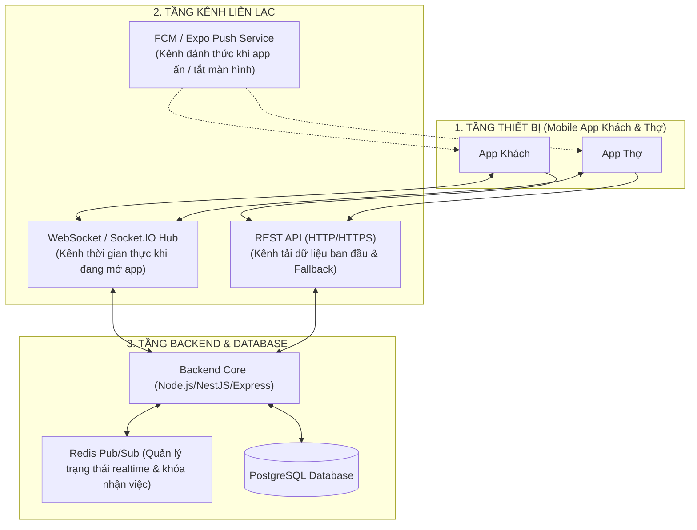

# BÁO CÁO PHÂN TÍCH TOÀN DIỆN: CÓ NÊN LÀM WEBSOCKET / REALTIME CHO HỆ THỐNG THỢ MINH ĐỨC?

> **Tài liệu chiến lược công nghệ cho Đội ngũ Backend & Mobile App**  
> Dự án: Hệ thống Điều phối Dịch vụ Kỹ thuật Tại nhà **Thợ Minh Đức**  
> Đánh giá: Ưu/nhược điểm, ma trận tính năng, so sánh công nghệ, chi phí hạ tầng và kiến trúc đề xuất.

---

## 1. CÂU HỎI CỐT LÕI: CÓ NÊN LÀM SOCKET KHÔNG?

> **CÂU TRẢ LỜI NGẮN GỌN:**  
> **CÓ, NHƯNG THEO MÔ HÌNH LAI (HYBRID ARCHITECTURE) — KHÔNG LÀM SOCKET CHO TẤT CẢ MỌI THỨ.**  
> 
> Nếu làm Socket cho toàn bộ app (từ xem danh mục, đặt đơn đến đọc lịch sử), hệ thống sẽ bị **quá tải kết nối (Connection Leak), tốn pin điện thoại cực nhanh và rất khó debug**.  
> Ngược lại, nếu **hoàn toàn không dùng Socket** mà chỉ dùng HTTP REST thông thường, các tính năng sống còn như **Thợ di chuyển GPS trên bản đồ, Chợ việc giật đơn 30 giây, Khách duyệt báo giá tại chỗ và Gạch nợ VietQR tự động** sẽ bị trễ, giật lag và phải bấm F5/kéo vuốt liên tục để tải lại.

---

## 2. MA TRẬN PHÂN TÍCH TỪNG TÍNH NĂNG: DÙNG CÔNG NGHỆ GÌ?

Không phải tính năng nào cũng cần Realtime Socket. Bảng dưới đây phân loại chính xác từng tác vụ nghiệp vụ:

| Nghiệp vụ cụ thể | Tần suất & Tính chất | WebSocket / Socket.IO | HTTP Short Polling | Push Notification (FCM/Expo) | Kết luận giải pháp tối ưu |
| :--- | :--- | :---: | :---: | :---: | :--- |
| **1. Khách đặt đơn $\rightarrow$ Hệ thống Tự Động Điều Phối (Auto-assign)** | Đơn được Backend chấm điểm & gán thẳng cho 1 Thợ tối ưu | 🟢 Nhận việc ngay khi mở app | 🔴 Không cần thiết | 🟢 **Rất quan trọng khi Thợ tắt app** (Push báo "Bạn có ca làm mới lúc 14h") | **Backend chạy thuật toán Auto-assign** $\rightarrow$ Gán thẳng đơn (`assigned`) $\rightarrow$ Bắn **Push Notification** báo thợ. Không cần chợ việc, không cần Socket tranh giành đơn. |
| **2. Thợ đang di chuyển (GPS Tracking trên bản đồ)** | Cực cao (cứ 5–10s cập nhật 1 lần khi thợ chạy xe) | 🟢 Tối ưu nhất (kết nối mở sẵn, gói tin siêu nhẹ ~100 bytes) | 🔴 Quá tải server (100 thợ x 5s = 20 req/s liên tục tạo TCP handshake) | 🔴 Không khả thi | **WebSocket thuần / Socket.IO** |
| **3. Thợ gửi Báo giá $\rightarrow$ Khách duyệt Đồng ý / Từ chối** | Khách & Thợ đang đứng cùng nhau tại nhà | 🟢 Cập nhật ngay trước mắt, thợ không cần reload | 🟡 Tạm chấp nhận nếu poll 5s | 🟡 Cần thiết nếu khách khóa màn hình | **Socket.IO (Room theo `request_id`)** |
| **4. Tiến độ % thi công & Tick bước quy trình** | Thỉnh thoảng (vài phút tick 1 bước) | 🟢 Phản hồi mượt | 🟢 Chấp nhận được | ⚪ Không cần thiết | **Socket.IO (Cùng room với đơn hàng)** |
| **5. Gạch nợ VietQR (Webhook ngân hàng báo về)** | Quan trọng sống còn về tiền tệ | 🟢 Màn hình tự nhảy tick xanh "Thành công" | 🟡 Poll 3-5s | 🟢 Thông báo tiền về | **Webhook BE $\rightarrow$ Emit Socket $\rightarrow$ Màn hình thanh toán tự chuyển trạng thái** |
| **6. Danh mục dịch vụ, bảng giá, chi tiết đơn cũ** | Thấp, dữ liệu đọc tĩnh | 🔴 Lãng phí kết nối | 🟢 Chuẩn RESTful HTTP cache | ⚪ Không liên quan | **REST API HTTP thông thường** |

---

## 3. SO SÁNH 4 CÔNG NGHỆ REALTIME PHỔ BIẾN

| Tiêu chí | 1. HTTP Polling (Hỏi vòng mỗi X giây) | 2. Server-Sent Events (SSE) | 3. WebSocket / Socket.IO | 4. Push Notification (FCM / Expo Push) |
| :--- | :--- | :--- | :--- | :--- |
| **Chiều truyền tin** | Client $\rightarrow$ Server (1 chiều) | Server $\rightarrow$ Client (1 chiều) | Client $\leftrightarrow$ Server (**2 chiều Full-Duplex**) | Server $\rightarrow$ Thiết bị (1 chiều) |
| **Độ trễ (Latency)** | Cao (phụ thuộc chu kỳ `setInterval`) | Thấp (~ mili-giây) | Cực thấp (~ mili-giây) | Trung bình (1 – 5 giây) |
| **Tải tài nguyên Server** | **Rất nặng** (liên tục tạo/đóng kết nối HTTP, lặp lại auth token) | Nhẹ (giữ 1 HTTP streaming) | **Rất nhẹ sau khi bắt tay (Handshake)** | Nhẹ (Google/Apple gánh hạ tầng) |
| **Hoạt động khi App tắt / Khóa màn hình** | ❌ **Chết hẳn** | ❌ **Chết hẳn** | ❌ **Bị hệ điều hành ngắt kết nối để tiết kiệm pin** |  **Hoạt động hoàn hảo** (Đánh thức app, rung chuông) |
| **Độ phức tạp triển khai** | Dễ nhất (chỉ cần `setInterval` gọi `fetch`) | Trung bình | Khá (cần quản lý Room, Disconnect, Reconnect) | Trung bình (cần đăng ký service tài khoản) |

---

## 4. RỦI RO LỚN NẾU CHỈ LÀM WEBSOCKET ĐƠN THUẦN (LỖI KINH ĐIỂN CỦA DỰ ÁN ĐỒ ÁN)

> [!WARNING]
> **RẤT NHIỀU NHÓM ĐỒ ÁN MẮC BẪY NÀY:**  
> Đội ngũ code WebSocket rất mượt khi mở 2 tab trình duyệt trên cùng 1 máy tính. Nhưng khi cài lên điện thoại thật thì:
> 1. **Thợ khóa màn hình hoặc chuyển sang Google Maps dẫn đường:** Hệ điều hành iOS/Android tự động **đóng socket sau 15–30 giây** để tiết kiệm RAM và pin. Lúc này hệ thống BE bắn đơn mới qua Socket thì Thợ **hoàn toàn không nhận được gì**!
> 2. **Khách hàng chuyển app sang ngân hàng để quét VietQR:** Socket ở App Khách bị đứt kết nối. Khi khách chuyển khoản xong quay lại app, Socket chưa kịp kết nối lại nên app vẫn hiện "Chưa thanh toán"!

👉 **Do đó, bắt buộc phải có KIẾN TRÚC LAI (HYBRID) kết hợp giữa Socket + Push Notification + Fallback Polling.**

---

## 5. KIẾN TRÚC ĐỀ XUẤT CHO HỆ THỐNG: MÔ HÌNH "3 CHÂN VẠC" (HYBRID ARCHITECTURE)

Hệ thống nên phân công rạch ròi 3 tầng công nghệ như sau:



### Nguyên lý hoạt động theo tình huống thực tế:

#### Kịch bản A: Hệ thống Tự Động Phân Công Thợ (Auto-Dispatching)
1. Khách đặt đơn $\rightarrow$ BE nhận request.
2. BE chạy thuật toán **Điều phối thông minh có trọng số (Smart Weighted Dispatching)**:
   * Lọc thợ: Đạt chuyên môn thiết bị + Không trùng slot giờ hẹn + Đang hoạt động.
   * Chấm điểm $Score = 40\% \text{Tải công việc} + 35\% \text{Khoảng cách} + 25\% \text{Đánh giá sao}$.
   * Chọn thợ có điểm cao nhất $\rightarrow$ Gán thẳng đơn với trạng thái `ASSIGNED`.
3. Thông báo cho Thợ:
   * **Bắn Push Notification (FCM/Expo)** thẳng vào máy thợ: *"Lịch mới: Vệ sinh máy lạnh lúc 14h tại Cầu Giấy"*.
   * Nếu thợ đang mở app $\rightarrow$ Socket gửi event `job:assigned` để tab "Lịch / Công việc" tự động nảy thêm ca làm mới mà thợ không cần reload. Khách hàng cũng ngay lập tức thấy thông tin thợ phụ trách (Tên, SĐT, Số sao).

#### Kịch bản B: Thợ di chuyển GPS tới nhà khách
1. Thợ bấm "Bắt đầu di chuyển" $\rightarrow$ App Thợ bật GPS background, emit sự kiện `tech:location` mỗi **8 giây** gửi `{ lat, lng, requestId }`.
2. Backend nhận toạ độ $\rightarrow$ Không cần ghi đĩa DB liên tục (tránh nát DB) mà chỉ lưu vào **Redis cache** (hết hạn sau 60s) và chuyển tiếp (Emit) ngay vào Room `order_<requestId>`.
3. Khách hàng đang mở màn hình theo dõi đơn $\rightarrow$ Nghe sự kiện `tech:location` và di chuyển mượt mà icon chiếc xe trên bản đồ.

#### Kịch bản C: Khách duyệt báo giá & Nghiệm thu
1. Thợ kiểm tra xong, bấm "Gửi báo giá" trên app $\rightarrow$ Gọi API `POST /quotation`.
2. BE xử lý xong emit sự kiện `order:quote_sent` vào Room `order_<requestId>`.
3. Màn hình Khách hàng lập tức bật Sheet báo giá: Có chi tiết vật tư, tiền công, giảm giá hạng thành viên $\rightarrow$ Khách bấm **[Đồng ý]**.
4. BE emit `order:quote_approved` $\rightarrow$ Màn hình Thợ nhảy sang trạng thái "Bắt đầu sửa chữa" ngay lập tức mà không cần hỏi lại khách.

#### Kịch bản D: Thanh toán VietQR & Gạch nợ tự động
1. Khách mở mã VietQR MBBank.
2. Khách dùng App Ngân hàng chuyển tiền thành công.
3. Ngân hàng gửi Webhook về Backend: `POST /api/v1/payments/webhook`.
4. Backend đối soát đúng số tiền và cú pháp mã đơn $\rightarrow$ Cập nhật `orders.paid = true`.
5. Backend bắn Socket sự kiện `payment:success` vào Room `order_<requestId>`.
6. Cả màn hình Khách và Thợ cùng lúc nảy pháo hoa tick xanh: *"Đã nhận đủ tiền. Kích hoạt bảo hành 60 ngày thành công!"*.

---

## 6. THIẾT KẾ PHÒNG (ROOMS) & CÁC SỰ KIỆN (EVENTS) CỤ THỂ CHO BE

Để tránh gửi nhầm thông tin của đơn này sang đơn khác hoặc thợ này sang thợ khác, Backend sử dụng cơ chế **Socket Rooms**:

### 1. Phân chia Room
* `user_<userId>`: Mỗi user (Khách/Thợ) khi đăng nhập sẽ tự động tham gia vào Room riêng của mình để nhận các thông báo cá nhân, biến động điểm thưởng, ví tiền.
* `order_<requestId>`: Khi Khách hoặc Thợ mở xem chi tiết đơn hàng số `123`, app sẽ gửi lệnh `join_order(123)`. Mọi tương tác của đơn hàng này chỉ phát tán trong nội bộ room đó.
* `tech_market_<area>`: Phòng dành cho các thợ trong cùng quận/khu vực để nhận tin việc mới mở.

### 2. Danh sách Sự kiện (Socket Events Contract)

| Tên Event (Sự kiện) | Hướng gửi | Payload dữ liệu | Mục đích |
| :--- | :---: | :--- | :--- |
| `join_room` | Client $\rightarrow$ Server | `{ room: "order_123" }` | Tham gia lắng nghe đơn hàng cụ thể |
| `leave_room` | Client $\rightarrow$ Server | `{ room: "order_123" }` | Rời phòng khi bấm Back thoát màn hình |
| `tech:location` | Thợ $\rightarrow$ Server $\rightarrow$ Khách | `{ requestId, lat, lng, etaMin, speed }` | Cập nhật vị trí di chuyển trực tiếp |
| `order:status_change` | Server $\rightarrow$ Cả hai | `{ requestId, newStatus, timestamp, actor }` | Nhảy trạng thái đơn (đang đến, đang làm, xong) |
| `order:quote_sent` | Server $\rightarrow$ Khách | `{ requestId, quoteId, total, items: [...] }` | Mở bảng báo giá để khách duyệt |
| `order:quote_decision` | Server $\rightarrow$ Thợ | `{ requestId, decision: "APPROVED"/"REJECTED", reason }` | Thợ biết khách đã duyệt hay từ chối |
| `order:progress_tick` | Server $\rightarrow$ Khách | `{ requestId, stepNo, stepTitle, percent }` | Khách thấy thợ hoàn thành từng bước quy trình |
| `payment:success` | Server $\rightarrow$ Cả hai | `{ requestId, amount, paidAt, method: "VIETQR" }` | Tự động hoàn tất thanh toán |
| `job:new` | Server $\rightarrow$ Thợ | `{ requestId, serviceName, slot, addressArea, price }` | Nảy đơn mới trong chợ việc |

---

## 7. CODE MẪU THAM KHẢO CHO BACKEND (NODE.JS + SOCKET.IO)

Backend có thể tích hợp Socket.IO siêu gọn gàng song song với REST API hiện tại:

```javascript
// server.js (Node.js / Express / Socket.IO)
const express = require('express');
const http = require('http');
const { Server } = require('socket.io');

const app = express();
const server = http.createServer(app);
const io = new Server(server, {
  cors: { origin: '*', methods: ['GET', 'POST'] }
});

// Middleware xác thực JWT token qua Socket Handshake
io.use((socket, next) => {
  const token = socket.handshake.auth?.token;
  if (!token) return next(new Error('Chưa đăng nhập'));
  try {
    const user = verifyJwt(token); // Giải mã user_id, role
    socket.user = user;
    next();
  } catch (err) {
    next(new Error('Token không hợp lệ'));
  }
});

io.on('connection', (socket) => {
  const userId = socket.user.id;
  socket.join(`user_${userId}`);
  console.log(`User ${userId} (${socket.user.role}) đã kết nối Socket`);

  // Khi xem đơn nào thì join vào room đơn đó
  socket.on('order:join', ({ requestId }) => {
    socket.join(`order_${requestId}`);
  });

  socket.on('order:leave', ({ requestId }) => {
    socket.leave(`order_${requestId}`);
  });

  // Thợ gửi toạ độ di chuyển GPS
  socket.on('tech:send_location', ({ requestId, lat, lng, etaMin }) => {
    // Chuyển tiếp ngay cho khách đang xem đơn
    socket.to(`order_${requestId}`).emit('tech:location_update', {
      lat,
      lng,
      etaMin,
      updatedAt: Date.now()
    });
  });

  socket.on('disconnect', () => {
    console.log(`User ${userId} đã ngắt kết nối`);
  });
});

// Hàm dùng chung cho các Controller REST API gọi khi có biến động
function emitOrderUpdate(requestId, eventName, data) {
  io.to(`order_${requestId}`).emit(eventName, data);
}

// Ví dụ khi Ngân hàng gọi Webhook thanh toán thành công
app.post('/api/v1/payments/webhook', async (req, res) => {
  const { orderCode, amount } = req.body;
  const order = await db.markOrderAsPaid(orderCode);
  
  // BẮN REALTIME CHO CẢ KHÁCH VÀ THỢ NGAY TẬP TỨC
  emitOrderUpdate(order.id, 'payment:success', {
    requestId: order.id,
    amount,
    paid: true
  });

  res.json({ ok: true });
});
```

---

## 8. KẾT LUẬN & LỘ TRÌNH TRIỂN KHAI KHUYẾN NGHỊ

### Lời khuyên cuối cùng:
1. **NÊN LÀM REALTIME**, vì đây là đồ án hệ thống dịch vụ theo yêu cầu (On-demand Service như Grab/Shopee). Nếu không có Realtime, đồ án sẽ mất đi 50% tính thuyết phục khi bảo vệ trước hội đồng.
2. **CHIẾN LƯỢC TRIỂN KHAI 2 BƯỚC CHO TEAM:**
   * **Giai đoạn 1 (Làm ngay trong 1-2 ngày tới):** Triển khai **Socket.IO** cho 3 tính năng nhìn thấy được ngay:
     * *(1)* Cập nhật trạng thái đơn & duyệt báo giá (Khách bấm $\rightarrow$ Thợ nhảy ngay).
     * *(2)* Tọa độ thợ di chuyển (GPS Tracking).
     * *(3)* Gạch nợ thanh toán VietQR tự động.
   * **Giai đoạn 2 (Dự phòng an toàn):** Cài đặt Fallback Polling nhẹ nhàng (cứ 15s gọi API 1 lần nếu Socket bị mất kết nối) để đảm bảo dù mạng 4G chập chờn thì đồ án vẫn chạy mượt mà, không bao giờ bị "đơ" giữa chừng!
