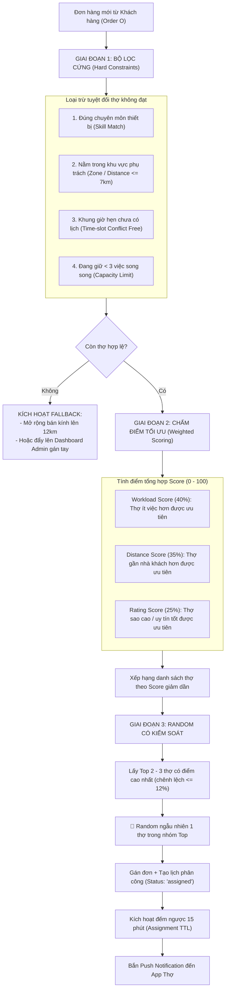

# TÀI LIỆU KỸ THUẬT: MÔ HÌNH ĐIỀU PHỐI THÔNG MINH CÓ TRỌNG SỐ CHO KỸ THUẬT VIÊN (HRMSS)
> **Dành cho:** Đội ngũ phát triển Backend (Backend Developer Team)  
> **Mục tiêu:** Thay thế cơ chế "Random nhận việc thuần túy" sang "Điều phối thông minh theo nghiệp vụ thợ công ty", tối ưu hóa quãng đường, đúng chuyên môn và cân bằng tải công việc.  
> **Phiên bản:** 2.0 (Đầy đủ thuật toán, CSDL, Code mẫu & Đặc tả API) | **Ngày cập nhật:** 08/11/2026  

---

## 📌 MỤC LỤC
1. [Bối cảnh nghiệp vụ & Lý do thay đổi cơ chế Random](#1-bối-cảnh-nghiệp-vụ--lý-do-thay-đổi-cơ-chế-random)
2. [Mô hình đề xuất: Điều phối thông minh có trọng số (Smart Weighted Dispatching)](#2-mô-hình-đề-xuất-điều-phối-thông-minh-có-trọng-số)
3. [Quy trình giải thuật 3 giai đoạn chi tiết](#3-quy-trình-giải-thuật-3-giai-đoạn-chi-tiết)
4. [Công thức toán học tính điểm ứng viên ($Score$)](#4-công-thức-toán-học-tính-điểm-ứng-viên-score)
5. [Thiết kế Cơ sở dữ liệu mẫu (Database Schema & Indexes)](#5-thiết-kế-cơ-sở-dữ-liệu-mẫu-database-schema)
6. [Code mẫu Backend hoàn chỉnh (TypeScript / Node.js)](#6-code-mẫu-backend-hoàn-chỉnh-typescript--nodejs)
7. [Đặc tả API Contract (Giao tiếp App Mobile ↔ Backend)](#7-đặc-tả-api-contract-giao-tiếp-app-mobile--backend)
8. [Xử lý các tình huống biên (Edge Cases & Fallback)](#8-xử-lý-các-tình-huống-biên-edge-cases--fallback)
9. [Sự đồng bộ trải nghiệm với giao diện Mobile App](#9-sự-đồng-bộ-trải-nghiệm-với-giao-diện-mobile-app)

---

## 1. BỐI CẢNH NGHIỆP VỤ & LÝ DO THAY ĐỔI CƠ CHẾ "RANDOM"

### 1.1. Thực trạng
Hiện tại Backend đang áp dụng cơ chế **Random nhận việc** (khi có đơn mới thì random ngẫu nhiên 1 thợ trong hệ thống để gán đơn).

### 1.2. Tại sao Random thuần túy 100% không phù hợp với thợ công ty?
Hệ thống Thợ HRMSS là mô hình **Dịch vụ kỹ thuật tại nhà của Doanh nghiệp (Field Service Management)**, bản chất khác hoàn toàn với dịch vụ gọi xe công nghệ (Grab/Gojek):

| Tiêu chí | Grab / Xe ôm công nghệ | Thợ kỹ thuật công ty (HRMSS) | Hậu quả nếu Backend Random 100% |
|---|---|---|---|
| **Yêu cầu kỹ năng** | Không phân biệt chuyên môn | Bắt buộc đúng tay nghề (Điện lạnh, Máy giặt, Bình nước nóng...) | Thợ sửa máy giặt bị random đi làm vệ sinh máy lạnh $\rightarrow$ Không làm được. |
| **Lịch hẹn** | Tức thời (đi ngay 5-10 phút) | Hẹn theo khung giờ cố định (`10h00 - 12h00`, `14h00 - 16h00`) | Giao việc trùng khung giờ thợ đang có đơn $\rightarrow$ Chắc chắn trễ hẹn hoặc bùng việc. |
| **Khu vực hoạt động** | Tự do di chuyển toàn thành phố | Phụ trách theo cụm Quận/Huyện hoặc bán kính $R \le 7\text{ km}$ | Thợ ở Q.12 bị random giao đơn ở Q.7 $\rightarrow$ Kẹt xe, chi phí xăng xe cao, khách chờ đợi. |
| **Chế độ lao động** | Đối tác tự do (Freelancer) | Kỹ thuật viên chính thức (Lương + KPI + Thưởng năng suất) | Một số thợ quá tải (5-6 việc/ngày), thợ khác ngồi chơi cả ngày $\rightarrow$ Mất cân bằng thu nhập. |

---

## 2. MÔ HÌNH ĐỀ XUẤT: ĐIỀU PHỐI THÔNG MINH CÓ TRỌNG SỐ

Thay vì "Random bừa" trên toàn bộ danh sách thợ, Backend triển khai mô hình **Smart Weighted Dispatching** gồm:
1. **Lọc cứng (Hard Filter):** Loại bỏ 100% thợ không đủ điều kiện (sai chuyên môn, trùng lịch, quá xa, quá tải).
2. **Chấm điểm tối ưu (Scoring):** Chấm điểm các thợ còn lại theo: **Cân bằng tải công việc (40%) + Khoảng cách di chuyển (35%) + Đánh giá sao (25%)**.
3. **Random có kiểm soát (Controlled Randomization):** Lấy ra **Top 2 hoặc Top 3 thợ có điểm số cao nhất** rồi random trong nhóm này.
   - *Lợi ích:* Vừa đảm bảo tính khách quan/ngẫu nhiên (tránh khiếu nại thiên vị nội bộ), vừa đảm bảo người nhận việc luôn là người làm tốt nhất, gần nhất và công bằng nhất.

---

## 3. QUY TRÌNH GIẢI THUẬT 3 GIAI ĐOẠN CHI TIẾT



---

## 4. CÔNG THỨC TOÁN HỌC TÍNH ĐIỂM ỨNG VIÊN ($Score$)

### 4.1. Giai đoạn 1: Điều kiện lọc cứng
Gọi $T$ là tập hợp tất cả thợ trong hệ thống. Thợ $t_i \in T$ chỉ được đưa vào danh sách ứng viên $T_{valid}$ khi thỏa mãn đồng thời:

$$\forall t_i \in T, \quad t_i \in T_{valid} \iff \big(C_{skill} \land C_{area} \land C_{time} \land C_{capacity}\big)$$

1. $C_{skill}$: $Order.category \in t_i.skills$
2. $C_{area}$: $Distance(t_i.station, Order.customer\_location) \le 7\text{ km}$ hoặc $t_i.area = Order.district$
3. $C_{time}$: Không tồn tại lịch làm việc của $t_i$ trùng với $(Order.date, Order.time\_slot)$
4. $C_{capacity}$: Số việc đang xử lý của $t_i < 3$ việc.

---

### 4.2. Giai đoạn 2: Công thức tính điểm tổng hợp ($Score$)
Với mỗi thợ $t_i \in T_{valid}$, tính điểm tổng hợp từ 0 đến 100:

$$Score(t_i) = 0.40 \times S_{workload}(t_i) + 0.35 \times S_{distance}(t_i, Order) + 0.25 \times S_{rating}(t_i)$$

#### ① Điểm cân bằng tải công việc ($S_{workload}$ - Trọng số 40%):
Nguyên tắc: Thợ càng ít việc trong ngày thì điểm càng cao để kéo đều việc cho mọi người.
$$S_{workload}(t_i) = \max\left(0, \; \left(1 - \frac{N_{today}(t_i)}{N_{max\_daily}}\right) \times 100\right)$$
*(Với $N_{max\_daily} = 5$ đơn/ngày. Thợ chưa có đơn nào: điểm 100; Thợ đã làm 3 đơn: điểm 40).*

#### ② Điểm khoảng cách di chuyển ($S_{distance}$ - Trọng số 35%):
Nguyên tắc: Càng gần nhà khách hàng càng được điểm cao, giảm thời gian di chuyển.
$$S_{distance}(t_i, Order) = \max\left(0, \; 100 - \frac{d(t_i, Order)}{R_{max}} \times 100\right)$$
*(Với $R_{max} = 7\text{ km}$. Khoảng cách 1.4km $\rightarrow$ Điểm: $100 - (1.4/7)*100 = 80$).*

#### ③ Điểm đánh giá chất lượng ($S_{rating}$ - Trọng số 25%):
Nguyên tắc: Thưởng điểm cho thợ duy trì thái độ tốt và tay nghề cao.
$$S_{rating}(t_i) = \left(\frac{Rating(t_i)}{5.0}\right) \times 100$$
*(Ví dụ: 4.8★ $\rightarrow$ Điểm: 96).*

---

### 4.3. Giai đoạn 3: Phân bổ ngẫu nhiên có kiểm soát
1. Sắp xếp danh sách $T_{valid}$ giảm dần theo $Score(t_i)$.
2. Lọc danh sách ứng viên sáng giá nhất:
   $$TopCandidates = \{ t \in T_{valid} \mid Score(t) \ge 0.88 \times Score(t_{max}) \} \quad (\text{Lấy tối đa 3 thợ})$$
3. **Random ngẫu nhiên 1 thợ** trong tập $TopCandidates$:
   $$P(t_k) = \frac{1}{|TopCandidates|}, \quad \forall t_k \in TopCandidates$$

---

## 5. THIẾT KẾ CƠ SỞ DỮ LIỆU MẪU (DATABASE SCHEMA)

Backend sử dụng PostgreSQL hoặc MySQL có thể tham khảo thiết kế schema sau:

```sql
-- 1. Bảng Kỹ thuật viên (Technicians)
CREATE TABLE technicians (
    id SERIAL PRIMARY KEY,
    code VARCHAR(20) UNIQUE NOT NULL,             -- vd: "THO-001"
    name VARCHAR(100) NOT NULL,
    phone VARCHAR(20) NOT NULL,
    skills JSONB NOT NULL,                         -- mảng chuyên môn: ["may-lanh", "tu-lanh", "may-giat"]
    service_area VARCHAR(100) NOT NULL,            -- khu vực trực: "Bình Thạnh", "Quận 1"
    station_lat DOUBLE PRECISION,                  -- tọa độ trạm đóng quân
    station_lng DOUBLE PRECISION,
    max_active_jobs INT DEFAULT 3,                 -- tối đa số việc song song
    rating DECIMAL(2,1) DEFAULT 5.0,              -- số sao đánh giá trung bình
    reputation_score INT DEFAULT 100,              -- điểm uy tín nội bộ
    is_active BOOLEAN DEFAULT TRUE,
    created_at TIMESTAMP DEFAULT CURRENT_TIMESTAMP
);
CREATE INDEX idx_tech_skills ON technicians USING GIN (skills);
CREATE INDEX idx_tech_area ON technicians(service_area);

-- 2. Bảng Lịch phân công của Thợ (Technician Schedules)
CREATE TABLE technician_schedules (
    id SERIAL PRIMARY KEY,
    tech_id INT REFERENCES technicians(id) ON DELETE CASCADE,
    order_id INT NOT NULL,
    work_date DATE NOT NULL,                      -- ngày làm việc: '2026-11-08'
    time_slot VARCHAR(50) NOT NULL,               -- khung giờ: '14h00 - 16h00'
    status VARCHAR(20) DEFAULT 'assigned',        -- 'assigned', 'confirmed', 'completed', 'cancelled'
    created_at TIMESTAMP DEFAULT CURRENT_TIMESTAMP,
    CONSTRAINT unique_tech_slot UNIQUE(tech_id, work_date, time_slot)
);
CREATE INDEX idx_sched_tech_date ON technician_schedules(tech_id, work_date);

-- 3. Bảng Nhật ký điều phối để theo dõi & đối soát (Dispatch Logs)
CREATE TABLE dispatch_logs (
    id SERIAL PRIMARY KEY,
    order_id INT NOT NULL,
    assigned_tech_id INT REFERENCES technicians(id),
    candidate_scores JSONB,                       -- lưu vết điểm số của các ứng viên để tra cứu khi khiếu nại
    status VARCHAR(20) DEFAULT 'pending_ack',     -- 'pending_ack', 'accepted', 'declined', 'timeout'
    decline_reason VARCHAR(255),
    expires_at TIMESTAMP NOT NULL,                -- thời điểm hết hạn 15 phút
    created_at TIMESTAMP DEFAULT CURRENT_TIMESTAMP
);
```

---

## 6. CODE MẪU BACKEND HOÀN CHỈNH (TYPESCRIPT / NODE.JS)

Backend có thể copy và điều chỉnh trực tiếp module điều phối này:

```typescript
// services/dispatchService.ts
import { db } from '../config/database';

interface OrderPayload {
  orderId: number;
  orderCode: string;
  category: string;        // vd: "may-lanh"
  bookingDate: string;     // vd: "2026-11-08"
  timeSlot: string;        // vd: "14h00 - 16h00"
  district: string;        // vd: "Bình Thạnh"
  customerLat?: number;
  customerLng?: number;
}

export async function smartDispatchOrder(order: OrderPayload) {
  // BƯỚC 1: LỌC CỨNG (Hard Constraints Query)
  const candidateResult = await db.query(`
    SELECT t.*, 
      (SELECT COUNT(*) FROM technician_schedules s 
       WHERE s.tech_id = t.id AND s.work_date = $1 AND s.status IN ('assigned', 'confirmed')) as active_count
    FROM technicians t
    WHERE t.is_active = TRUE
      AND t.skills ? $2
      AND t.service_area = $3
      AND NOT EXISTS (
        SELECT 1 FROM technician_schedules s
        WHERE s.tech_id = t.id 
          AND s.work_date = $1 
          AND s.time_slot = $4
          AND s.status IN ('assigned', 'confirmed')
      )
  `, [order.bookingDate, order.category, order.district, order.timeSlot]);

  // Lọc ngưỡng việc song song (< 3 việc)
  const eligibleTechs = candidateResult.rows.filter(t => t.active_count < t.max_active_jobs);

  // Kịch bản ngoại lệ: Không có thợ nào thỏa mãn
  if (eligibleTechs.length === 0) {
    console.warn(`[Dispatch] Không có thợ khả dụng cho đơn ${order.orderCode} -> Chuyển Fallback`);
    return handleFallback(order);
  }

  // BƯỚC 2: CHẤM ĐIỂM TỐI ƯU CÓ TRỌNG SỐ (Weighted Scoring)
  const scoredTechs = eligibleTechs.map(tech => {
    // 1. Điểm cân bằng tải (tối đa 5 việc/ngày)
    const workloadScore = Math.max(0, (1 - (tech.active_count / 5)) * 100);

    // 2. Điểm khoảng cách (giả lập 3.0km nếu chưa có tọa độ GPS chi tiết)
    const distanceKm = getDistanceKm(tech.station_lat, tech.station_lng, order.customerLat, order.customerLng) || 3.0;
    const distanceScore = Math.max(0, 100 - (distanceKm / 7) * 100);

    // 3. Điểm đánh giá (Rating)
    const ratingScore = (Number(tech.rating || 5.0) / 5.0) * 100;

    // Tổng điểm theo trọng số
    const totalScore = (workloadScore * 0.40) + (distanceScore * 0.35) + (ratingScore * 0.25);
    return { ...tech, totalScore, distanceKm };
  });

  // Sắp xếp điểm giảm dần
  scoredTechs.sort((a, b) => b.totalScore - a.totalScore);

  // BƯỚC 3: RANDOM CÓ KIỂM SOÁT TRONG TOP 2 - 3
  const topScore = scoredTechs[0].totalScore;
  const topCandidates = scoredTechs.filter(t => t.totalScore >= topScore * 0.88).slice(0, 3);
  const selectedTech = topCandidates[Math.floor(Math.random() * topCandidates.length)];

  // BƯỚC 4: LƯU LỊCH & THIẾT LẬP TIMEOUT 15 PHÚT
  const expiresAt = new Date(Date.now() + 15 * 60 * 1000); // 15 phút sau

  await db.query(`
    INSERT INTO technician_schedules (tech_id, order_id, work_date, time_slot, status)
    VALUES ($1, $2, $3, $4, 'assigned')
  `, [selectedTech.id, order.orderId, order.bookingDate, order.timeSlot]);

  await db.query(`
    INSERT INTO dispatch_logs (order_id, assigned_tech_id, candidate_scores, expires_at)
    VALUES ($1, $2, $3, $4)
  `, [order.orderId, selectedTech.id, JSON.stringify(scoredTechs), expiresAt]);

  // BƯỚC 5: GỬI PUSH NOTIFICATION ĐẾN MOBILE APP CỦA THỢ
  await sendPushNotification(selectedTech.id, {
    title: 'Việc mới được phân công!',
    body: `Đơn ${order.orderCode} tại ${order.district}. Bạn có 15 phút để bấm Tiếp nhận ca.`,
    data: { orderCode: order.orderCode }
  });

  return { success: true, assignedTech: selectedTech };
}
```

---

## 7. ĐẶC TẢ API CONTRACT (GIAO TIẾP APP MOBILE ↔ BACKEND)

### 7.1. Lấy danh sách việc được phân công cho thợ
- **Endpoint:** `GET /api/v1/tech/assigned-jobs`
- **Headers:** `Authorization: Bearer <tech_jwt_token>`
- **Response (200 OK):**
```json
{
  "success": true,
  "data": [
    {
      "order_code": "DMX261108-01",
      "service_name": "Vệ sinh máy lạnh treo tường (Inverter)",
      "category": "may-lanh",
      "booking_date": "2026-11-08",
      "time_slot": "14h00 - 16h00",
      "customer": {
        "name": "Nguyễn Văn A",
        "phone_masked": "0912***456",
        "address": "123 Điện Biên Phủ, Phường 15, Bình Thạnh, TP.HCM",
        "distance_km": 2.8
      },
      "assigned_at": "2026-11-08T11:15:00Z",
      "expires_at": "2026-11-08T11:30:00Z",
      "dispatch_note": "Hệ thống tự động phân công theo chuyên môn Điện lạnh & khu vực Bình Thạnh"
    }
  ]
}
```

### 7.2. Thợ xác nhận "Tiếp nhận ca"
- **Endpoint:** `POST /api/v1/tech/jobs/:order_code/accept`
- **Headers:** `Authorization: Bearer <tech_jwt_token>`
- **Response (200 OK):**
```json
{
  "success": true,
  "message": "Đã tiếp nhận ca làm việc thành công",
  "order": {
    "order_code": "DMX261108-01",
    "status": "confirmed",
    "customer_full_phone": "0912345678"
  }
}
```

### 7.3. Thợ từ chối ca kèm lý do
- **Endpoint:** `POST /api/v1/tech/jobs/:order_code/decline`
- **Headers:** `Authorization: Bearer <tech_jwt_token>`
- **Request Body:**
```json
{
  "reason_code": "VEHICLE_BREAKDOWN", 
  "reason_note": "Xe bị thủng săm đang trên đường sửa"
}
```
- **Response (200 OK):**
```json
{
  "success": true,
  "message": "Đã ghi nhận lý do từ chối. Hệ thống tự động chuyển tiếp đơn cho kỹ thuật viên tiếp theo."
}
```

---

## 8. XỬ LÝ CÁC TÌNH HUỐNG BIÊN (EDGE CASES & FALLBACK)

1. **Hết thời hạn 15 phút thợ không bấm tiếp nhận (Assignment Timeout):**
   - Backend dùng Redis TTL Key Expiration hoặc Cron Job quét bảng `dispatch_logs` mỗi 1 phút (`WHERE status = 'pending_ack' AND expires_at < NOW()`).
   - Tự động huỷ gán với thợ cũ (ghi log `timeout`), lấy ứng viên điểm cao thứ 2 trong `candidate_scores` để gán tiếp.
2. **Thợ từ chối ca:**
   - Hệ thống cập nhật trạng thái lịch của thợ thành `declined`.
   - Lập tức điều phối cho ứng viên tiếp theo trong danh sách đã chấm điểm.
3. **Khu vực không có thợ khả dụng (Zero Candidate):**
   - Tự động mở rộng bán kính tìm kiếm $R_{max}$ từ $7\text{ km} \rightarrow 12\text{ km}$.
   - Nếu vẫn không có: Bắn sự kiện WebSocket/Notification lên Dashboard **Admin Web** (Trưởng trạm) để điều phối thủ công hoặc liên hệ khách hàng dời lịch hẹn.

---

## 9. SỰ ĐỒNG BỘ TRẢI NGHIỆM VỚI GIAO DIỆN MOBILE APP

Phía Mobile App (React Native) hiện tại đã được cấu trúc và thiết kế hoàn toàn khớp với tài liệu này:
- **Phía App Thợ:** 
  - Không còn cơ chế "Bật/Tắt trực tuyến để cướp đơn" kiểu Grab.
  - Thẻ đơn hiển thị rõ nhãn: `📋 CA ĐƯỢC PHÂN CÔNG`, đếm ngược `⏳ Còn 14:30 tiếp nhận`, hiển thị lý do điều phối minh bạch: `✓ Đúng chuyên môn`, `✓ Thuộc khu vực phụ trách`, `✓ Khung giờ hẹn trống`.
  - Nút bấm chuẩn tác phong công ty: `[ Tiếp nhận ca ]` và `[ Từ chối ca ]`.
- **Phía App Khách:**
  - Hiển thị thẻ: `⚙️ Hệ thống đang điều phối Kỹ thuật viên chuyên trách...` kèm 3 cam kết doanh nghiệp (Đúng chuyên môn, Đúng hẹn, Bảo hành 60 ngày).
  - Khi đã có thợ nhận: Hiện huy hiệu `KTV chuyên trách` cùng số sao uy tín và nút gọi điện thoại trực tiếp.
