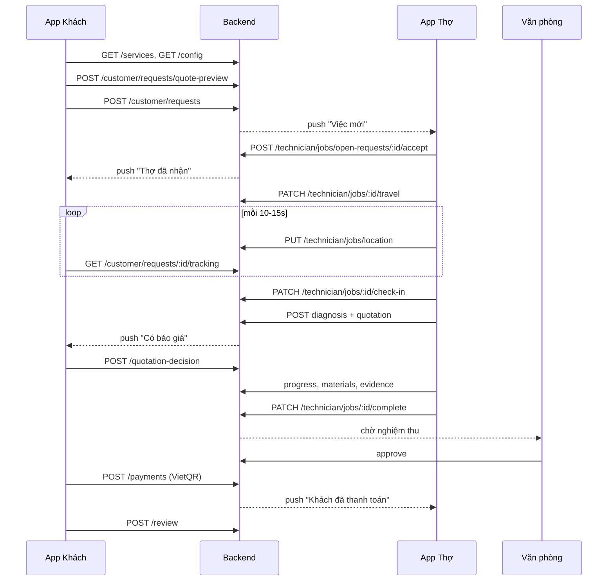
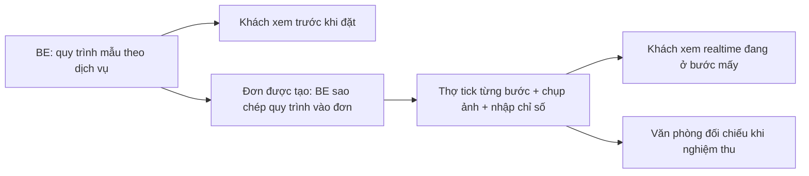

# Phân tích API theo luồng: Khách bấm dịch vụ → Đặt đơn → Thợ làm → Hoàn tất

> Tài liệu cho team BE. Đối chiếu từng bước với code app hiện tại: [api.js](file:///c:/Users/Linh/Downloads/đồ%20án/appmobile/src/services/api.js), [AppContext.js](file:///c:/Users/Linh/Downloads/đồ%20án/appmobile/src/context/AppContext.js), [syncService.js](file:///c:/Users/Linh/Downloads/đồ%20án/appmobile/src/services/syncService.js), [data.js](file:///c:/Users/Linh/Downloads/đồ%20án/appmobile/src/constants/data.js).
>
> Ký hiệu: ✅ **Đã có API** (app đang gọi) · 🟡 **Có API nhưng thiếu dữ liệu** · 🔴 **Chưa có API — app đang giả lập trên máy** · 📌 **Để fix cứng**

---

## 0. Nguyên tắc chia API / fix cứng

| Loại dữ liệu | Quyết định | Lý do |
| :--- | :--- | :--- |
| Thứ gì **ảnh hưởng tới tiền** (giá, giảm giá, phí, voucher, hạng) | **API** — BE tính, app chỉ hiển thị | Tránh khách sửa giá ở client; Khách & Thợ & Văn phòng phải thấy cùng một con số |
| Thứ **dùng chung giữa 2 actor** (trạng thái đơn, báo giá, ảnh, vật tư, tiến độ) | **API** | Khách và Thợ dùng 2 máy khác nhau, local state không đồng bộ được |
| Thứ **cần lưu vết / kiểm toán** (check-in, chữ ký, thanh toán, bảo hành) | **API** | Văn phòng duyệt nghiệm thu & bảo hành dựa trên log này |
| **Cấu hình nghiệp vụ** ít đổi (khung giờ, chính sách trễ, hạng thành viên, combo) | **API cấu hình** `GET /config` + app cache, có giá trị fallback fix cứng | Đổi chính sách không cần build lại app |
| **Nội dung tĩnh** (FAQ, điều khoản, quy trình 4–6 bước, mẹo hay, cam kết, icon, màu) | 📌 **Fix cứng** | Không có logic, không phụ thuộc user |
| **Trạng thái UI** (giỏ hàng, tab đang mở, lịch sử tìm kiếm, tip đã ẩn) | 📌 **Local** | Thuộc riêng thiết bị |

---

## 1. Sơ đồ tổng thể



---

## 2. Chi tiết từng bước

### BƯỚC 1 — Xem danh mục & chi tiết dịch vụ (Home / Dịch vụ / Detail)

| Thành phần trên màn hình | Hiện trạng | Đề xuất |
| :--- | :--- | :--- |
| Danh sách dịch vụ, tên, **giá**, giá gốc, nhóm thiết bị | 🟡 `GET /services?limit=100` đã gọi, nhưng app vẫn giữ mảng `SERVICES` fix cứng trong `data.js` làm nguồn chính, chỉ map qua `dbId` | **API là nguồn duy nhất cho giá**. Mảng trong `data.js` chỉ dùng làm fallback offline |
| Danh mục thiết bị (Máy lạnh, Máy giặt…) + icon | 📌 fix cứng | `GET /service-categories` nếu BE muốn thêm danh mục mới không cần build app; icon map vẫn fix cứng ở app |
| Loại dịch vụ: Bảo dưỡng / Sửa chữa / Bảo hành / Trọn đời | 📌 suy ra từ tiền tố id (`vs-`, `sc-`, `td-`, `gas-`) | BE trả thêm trường `service_type` (`CLEAN`/`REPAIR`/`GAS`/`LIFETIME`) — **không suy từ id** |
| Cờ “giá tham khảo – báo giá sau khảo sát” | 📌 `isEstimate()` suy từ loại | BE trả `price_type: FIXED \| ESTIMATE \| INSPECTION_FEE` |
| Lượt bán, số sao, số đánh giá | 📌 chuỗi cứng (`'Đã bán 631,7k'`) | `GET /services/:id` trả `rating_avg`, `review_count`, `sold_count` (BE tổng hợp từ đơn hoàn tất) |
| Đánh giá của khách trên trang chi tiết | 📌 `REVIEWS_BY_ID` cứng | `GET /services/:id/reviews?limit=10` |
| Thời gian bảo hành của dịch vụ | 📌 `'BH 60 ngày'` | Trường `warranty_days` trong service |
| **Quy trình thực hiện 4–6 bước** (“Các bước thực hiện chuẩn tại nhà”) | 🔴 `stepsFor()` cứng theo loại dịch vụ | **Chuyển sang API** — xem riêng mục **2A** bên dưới (đây là phần thợ phải làm theo, không chỉ là nội dung giới thiệu) |
| Dụng cụ, thời lượng, mô tả, video | 📌 fix cứng | Nội dung giới thiệu tĩnh; có thể trả kèm service nếu BE muốn quản lý |
| Bảng giá vật tư niêm yết | 🟡 có `GET /technician/jobs/materials` nhưng chỉ cho Thợ | Mở thêm `GET /materials` **public** cho Khách đối chiếu giá |

---

### 2A — CÁC BƯỚC THỰC HIỆN (quy trình thi công từng dịch vụ)

**Hiện trạng trong code:**

| Nơi dùng | Dữ liệu | Ghi chú |
| :--- | :--- | :--- |
| Khách – trang chi tiết dịch vụ ([BookingScreens.js](file:///c:/Users/Linh/Downloads/đồ%20án/appmobile/src/screens/booking/BookingScreens.js#L139-L150), [L235](file:///c:/Users/Linh/Downloads/đồ%20án/appmobile/src/screens/booking/BookingScreens.js#L235)) | `stepsFor(service)` trong [data.js](file:///c:/Users/Linh/Downloads/đồ%20án/appmobile/src/constants/data.js#L98-L149): `CLEAN_STEPS` (máy giặt, tủ lạnh), `KIND_STEPS` (clean / gas / install / repair / lifetime) | Chỉ để **hiển thị** cho khách xem |
| `PROCESS_STEPS` (6 bước vệ sinh máy lạnh) | [data.js L68-L75](file:///c:/Users/Linh/Downloads/đồ%20án/appmobile/src/constants/data.js#L68-L75) | **Không màn hình nào dùng** — dữ liệu thừa |
| Thợ – màn làm việc ([TechScreens.js L1745](file:///c:/Users/Linh/Downloads/đồ%20án/appmobile/src/screens/tech/TechScreens.js#L1745)) | Tiến độ chỉ có 4 nút chọn **25% / 50% / 75% / 100%** + ghi chú tự do | **Không gắn với các bước** khách đã được hứa |

> [!IMPORTANT]
> **Lệch nghiệp vụ:** Khách được xem “Bước 1: Kiểm tra trước vệ sinh → … → Bước 6: Nghiệm thu”, nhưng app Thợ **không có các bước này** để tick. Thợ chỉ chọn 25/50/75/100%. Khách không biết thợ đang ở bước nào, và Văn phòng không có căn cứ đối chiếu khi nghiệm thu (WF2).

**Đề xuất: biến “Các bước thực hiện” thành checklist thi công thật, lưu ở BE**



| # | API | Ai gọi | Mô tả |
| :-- | :--- | :--- | :--- |
| 1 | `GET /services/:id/procedure` | Khách (trang chi tiết) | Trả quy trình mẫu: `steps[{ step_no, title, items[], require_photo, require_measure }]` |
| 2 | *(tự động khi `POST /customer/requests`)* | BE | Sao chép quy trình mẫu vào đơn (`request_procedure_step`) — để sau này BE đổi quy trình thì đơn cũ không bị đổi theo |
| 3 | `GET /technician/jobs/:id/procedure` | Thợ | Danh sách bước của đơn + trạng thái từng bước `PENDING / DONE / SKIPPED` |
| 4 | `PATCH /technician/jobs/:id/procedure/:stepNo` | Thợ | Body: `{ status: "DONE", checked_items: [...], photo_ids: [...], measurements: { "nhiet_do_gio": 12, "dong_dien_A": 4.2, "ap_suat_gas_psi": 140 }, note }` |
| 5 | `GET /customer/requests/:id` (trả thêm `procedure[]`) | Khách | Hiện “Thợ đang ở Bước 3/6: Vệ sinh dàn nóng” thay cho thanh % chung chung |
| 6 | *(BE tự tính)* | BE | `progress_percent = số bước DONE / tổng bước` — **bỏ** 4 nút 25/50/75/100% ở app |
| 7 | Ràng buộc ở `PATCH /complete` | BE | Từ chối hoàn thành (422) nếu còn bước bắt buộc chưa DONE hoặc thiếu ảnh bắt buộc |

**Ví dụ dữ liệu quy trình mẫu BE trả về (vệ sinh máy lạnh):**
```json
{
  "service_id": 80,
  "steps": [
    { "step_no": 1, "title": "Kiểm tra trước vệ sinh",
      "items": ["Ghi nhận tình trạng", "Chỉ số tốc độ gió", "Chỉ số nhiệt độ"],
      "require_photo": true, "measures": ["toc_do_gio", "nhiet_do_gio"] },
    { "step_no": 2, "title": "Vệ sinh dàn lạnh", "items": ["Bật nắp trước máy và chụp hình"], "require_photo": true },
    { "step_no": 3, "title": "Vệ sinh dàn nóng", "items": ["Xịt rửa cánh quạt, các góc cạnh, mặt sau"] },
    { "step_no": 4, "title": "Kiểm tra sau vệ sinh",
      "items": ["Khối lượng gas", "Đo dòng điện", "Tốc độ gió", "Nhiệt độ"],
      "require_photo": true, "measures": ["ap_suat_gas", "dong_dien", "toc_do_gio", "nhiet_do_gio"] },
    { "step_no": 5, "title": "Vệ sinh khu vực", "items": ["Dọn dẹp khu vực thi công"] },
    { "step_no": 6, "title": "Nghiệm thu và bàn giao", "items": ["Khách xác nhận", "Ký biên bản"] }
  ]
}
```

**Bảng gợi ý BE (PostgreSQL):**
- `service_procedure_template (template_id, service_id, step_no, title, items jsonb, require_photo, measures jsonb)`
- `request_procedure_step (id, request_id, step_no, title, items jsonb, status, checked_items jsonb, measurements jsonb, note, done_at, done_by)`
- Ảnh của bước dùng chung bảng evidence (thêm cột `step_no`)

**Các danh mục cùng loại cũng nên xử lý giống vậy:**

| Danh mục hiện fix cứng | Dùng ở | Đề xuất |
| :--- | :--- | :--- |
| `SAFETY_CHECKLIST_ITEMS` (4 mục an toàn trước khi đóng đơn) | Thợ tick khi hoàn thành; Khách xem trên biên bản | `GET /config` → `safety_checklist[]`; gửi `safety_checklist[]` có cấu trúc trong `PATCH /complete` (hiện bị nối thành 1 chuỗi `testing_result`) |
| `DIAG_TAGS` (thẻ triệu chứng gợi ý khi chẩn đoán) | Thợ | `GET /diagnosis-tags?category=` hoặc trong `/config` |
| `SITE_CONDITIONS` (nhà phố / chung cư / vị trí cao / văn phòng) | Khách chọn khi đặt | `/config` → `site_conditions[]`; gửi `site_condition_id` khi đặt đơn |
| `ORDER_STEPS` / `TECH_ORDER_STEPS` (timeline trạng thái đơn) | Cả 2 app | 📌 **Giữ fix cứng** — chỉ là nhãn hiển thị của state machine, map theo `request_status` BE trả |

---

### BƯỚC 2 — Giỏ hàng & Combo nhiều máy

| Thành phần | Hiện trạng | Đề xuất |
| :--- | :--- | :--- |
| Thêm/bớt/xoá dịch vụ trong giỏ | 📌 local | **Giữ local** — không cần API |
| Ưu đãi combo (2 máy −5% tối đa 50k, 3 máy −10% tối đa 120k) | 🔴 `comboDiscountFor()` tính ở app | Chuyển vào **API tính giá** (Bước 3.8). Quy tắc lấy từ `GET /config` để hiển thị gợi ý |

---

### BƯỚC 3 — Màn hình Đặt lịch (Checkout)

| # | Thành phần | Hiện trạng | Đề xuất API |
| :-- | :--- | :--- | :--- |
| 3.1 | **Kiểm tra email đã xác thực** trước khi đặt | ✅ `GET /auth/email-verification/status` | BE cũng phải **chặn ở `POST /customer/requests`** (trả 403 `EMAIL_NOT_VERIFIED`), không chỉ dựa vào app |
| 3.2 | **Địa chỉ** — chọn / thêm mới | ✅ `GET/POST /customer/addresses` | Bổ sung `PATCH /customer/addresses/:id`, `DELETE /customer/addresses/:id`, `PATCH .../:id/default`. Nên trả **`lat/lng`** (BE geocode) — app đang dùng toạ độ cứng `21.0367, 105.7823` để tính quãng đường |
| 3.3 | **Thiết bị của khách** (loại, hãng, phòng, lần bảo dưỡng gần nhất) | 🔴 local `s.devices`; `lookupHrmssPurchasedDevices()` sinh thiết bị giả theo SĐT | `GET/POST/PATCH/DELETE /customer/devices`; `GET /customer/devices/lookup?phone=` để đồng bộ thiết bị đã mua. Gửi `device_id` khi đặt đơn |
| 3.4 | **Ngày & khung giờ** | 📌 `TIME_SLOTS` cứng 08h–20h; luật “cách hiện tại ≥ 45 phút” tính ở app | `GET /booking/slots?date=YYYY-MM-DD&area=&service_ids=` → trả slot nào còn **thợ trống**. BE validate lại luật 45 phút |
| 3.5 | **Điều kiện vị trí thi công** (tầng cao, cần thang, cần đăng ký BQL…) | 🔴 gửi kèm `payload.siteCondition` nhưng **không đẩy lên API** | Thêm field `site_conditions: string[]` vào `POST /customer/requests` |
| 3.6 | **Ảnh lỗi / vị trí** (tối đa 5 ảnh) | 🔴 chỉ lưu URI local | `POST /uploads` (multipart) → trả `file_id`; gửi `attachment_ids[]` trong request |
| 3.7 | **Ghi chú / mô tả lỗi** | ✅ gửi `problem_description` | — |
| 3.8 | **Voucher** (`THO20`, `MINHDUC10`, voucher đổi điểm) | 🔴 `VOUCHERS` cứng + `voucherDiscount()` tính ở app | `GET /customer/vouchers` (ví voucher); `POST /vouchers/validate { code, service_ids, subtotal }` |
| 3.9 | **Giảm giá theo hạng thành viên** (Vàng −5%, Kim cương −10% vật tư; BH 60/75/90/120 ngày) | 🔴 `TIERS` cứng + `tierOf(lifetimePoints)` ở app | `GET /customer/membership` → `{ tier, lifetime_points, points, warranty_days, part_discount_percent, next_tier }` |
| 3.10 | **Tổng tiền dự kiến** | 🔴 app tự cộng: giá − giảm SP − combo − voucher | **API mới quan trọng:** `POST /customer/requests/quote-preview { items, voucher_code, address_id }` → `{ goods, product_discount, combo_discount, voucher_discount, total, lines[] }`. App **chỉ hiển thị** |
| 3.11 | **Phương thức thanh toán** (VietQR / Tiền mặt) | 🔴 chỉ lưu chuỗi `payment`, không gửi API; syncService luôn gán cứng `'Chuyển khoản VietQR (MBBank)'` | Thêm `payment_method: VIETQR \| CASH` vào `POST /customer/requests`; BE trả lại đúng giá trị |

---

### BƯỚC 4 — Bấm “Đặt lịch”

| Thành phần | Hiện trạng | Đề xuất |
| :--- | :--- | :--- |
| Tạo đơn | 🟡 `POST /customer/requests` đã gọi, nhưng **app tự sinh mã `MD123456`** và tạo đơn local trước, gọi API **không chờ** (fire-and-forget, nuốt lỗi) | App phải **chờ API trả `request_code`** rồi mới sang màn Success. Nếu lỗi → báo lỗi, không tạo đơn ảo |
| Payload hiện gửi | `service_address_id \| new_address`, `preferred_time`, `problem_description`, `items[{service_id, notes}]` | Bổ sung: `device_id`, `site_conditions[]`, `attachment_ids[]`, `voucher_code`, `payment_method`, `preferred_slot_end` |
| Số lượng | App nhân bản item theo `qty` (tối đa 10) | BE nhận `quantity` trực tiếp trong item |
| Thông báo “Đặt lịch thành công” cho khách / “Việc mới” cho thợ | 🔴 tạo local bằng `pushNotif`/`pushTech` | BE sinh notification + gửi **push (FCM/Expo Push)** — xem Bước 14 |

**Response mong muốn:**
```json
{ "request": { "request_id": 123, "request_code": "MD261110-01", "request_status": "RECEIVED",
  "total_estimate": 360000, "payment_method": "VIETQR", "created_at": "..." } }
```

---

### BƯỚC 5 — Đơn đang chờ thợ (phía Khách)

| Thành phần | Hiện trạng | Đề xuất |
| :--- | :--- | :--- |
| Danh sách đơn / chi tiết đơn | ✅ `GET /customer/requests?status=ALL` · có sẵn `getCustomerRequestDetail` nhưng **chưa dùng** | Màn chi tiết đơn nên gọi `GET /customer/requests/:id` để lấy timeline, báo giá, ảnh, vật tư đầy đủ |
| **Sửa yêu cầu** (đổi ngày/giờ, mô tả, ảnh) khi chưa có thợ | 🔴 `updatePendingRequest` chỉ sửa local | `PATCH /customer/requests/:id` — chỉ cho phép khi `RECEIVED` |
| **Huỷ đơn** | ✅ `PATCH /customer/requests/:id/cancel` | BE quyết định **phí kiểm tra** và trả `cancellation_fee` — hiện app **đoán phí 100.000đ bằng regex đọc chuỗi `reason`** (rất dễ sai) |

---

### BƯỚC 6 — Điều phối & Thợ nhận việc (phía Thợ)

| Thành phần | Hiện trạng | Đề xuất |
| :--- | :--- | :--- |
| Danh sách việc mới (chợ việc) | ✅ `GET /technician/jobs/open-requests` | BE lọc theo **kỹ năng + khu vực + lịch trống** của thợ; trả `distance_km`, `match_score`. App đang tự tính `matchJobForTech()` |
| Việc của tôi | ✅ `GET /technician/jobs?status=ALL` | — |
| **Nhận việc** | ✅ `POST /technician/jobs/open-requests/:id/accept` | BE xử lý **tranh chấp 2 thợ cùng nhận** (lock), trả 409 nếu đã có người nhận |
| **Từ chối việc** | 🔴 `declineJob` local | `POST /technician/jobs/open-requests/:id/decline { reason }` |
| **Trả việc sau khi đã nhận** (phạt điểm uy tín) | 🔴 `releaseJob` local + `assessCancelAfterAccept` | `POST /technician/jobs/:id/release { reason }` → BE tính phạt, đưa đơn về `RECEIVED`, trả `penalty` |
| Bật/tắt nhận việc (online/offline) | 🔴 `setTechOnline` local | `PATCH /technician/me/availability { online }` |
| Hồ sơ thợ: tên, mã, sao, điểm uy tín, bị khoá | 🔴 **`TECH_ME` cứng** (`Hoàng Văn Thọ – MD1024`) | `GET /technician/me` → `{ name, code, phone, rating, jobs_done, reputation, locked, lock_reason, skills, areas }` |

> [!WARNING]
> Trong `syncService.js`, khi Khách tải đơn từ BE, trường `tech` **luôn bị gán cứng = `TECH_ME`**. Nghĩa là mọi khách đều thấy thợ “Hoàng Văn Thọ”. BE cần trả `assigned_technician { name, code, phone, rating, avatar }` trong `GET /customer/requests`.

---

### BƯỚC 7 — Thợ di chuyển & Khách theo dõi realtime

| Thành phần | Hiện trạng | Đề xuất |
| :--- | :--- | :--- |
| Bấm “Bắt đầu di chuyển” → trạng thái `onway` | 🔴 chỉ đổi local + gửi 1 lần toạ độ | `PATCH /technician/jobs/:id/travel` → BE đổi visit sang `EN_ROUTE`, lưu `travel_started_at`, push cho khách |
| Gửi vị trí | ✅ `PUT /technician/jobs/location` — nhưng toạ độ là **giả** (đích + 0.018) | App lấy GPS thật (`expo-location`), gửi mỗi 10–15 giây |
| Khách xem bản đồ / ETA | 🔴 `tickTracking` + `advanceTracking()` **mô phỏng** tiến độ | `GET /customer/requests/:id/tracking` → `{ lat, lng, eta_min, distance_km, updated_at }` hoặc **WebSocket** `ws /realtime?request_id=` |
| Cảnh báo quá giờ hẹn | 📌 `TECH_POLICY.lateGraceMin` cứng | Chính sách lấy từ `GET /config`; BE trả cờ `is_late` |

---

### BƯỚC 8 — Check-in tại nhà khách

| Thành phần | Hiện trạng | Đề xuất |
| :--- | :--- | :--- |
| Check-in GPS (kiểm tra bán kính) | 🟡 gọi `PATCH /technician/jobs/:id/start` + gửi location | Đổi thành `PATCH /technician/jobs/:id/check-in { lat, lng, accuracy }` — **BE kiểm tra khoảng cách** tới địa chỉ (≤ 200 m) |
| Quét QR xác minh khách (`MINHDUC:<SĐT>`) | 🔴 `verifyCustomerQR` so chuỗi ở app | `POST /technician/jobs/:id/verify-customer { qr_payload }` |
| **Tính trễ hẹn & đền bù cho khách** (trễ 21–45′ −20% max 100k; >45′ −50% max 200k) | 🔴 `assessLateness()` tính ở app, lưu `lateCompensation` local | **BE tính** khi check-in, trả `late_minutes`, `late_compensation { percent, max_discount, amount }`, trừ điểm uy tín thợ |

---

### BƯỚC 9 — Chẩn đoán & Báo giá

| Thành phần | Hiện trạng | Đề xuất |
| :--- | :--- | :--- |
| Ghi chẩn đoán (triệu chứng, kết luận, đề xuất) | ✅ `POST /technician/jobs/:id/diagnosis` | — |
| Lập báo giá: dòng công + dòng vật tư kho + vật tư mua ngoài | ✅ `POST /technician/jobs/:id/quotation { quotation_type, items }` | Mỗi item cần: `item_type (LABOR\|MATERIAL\|EXTERNAL_PART)`, `material_id?`, `description`, `quantity`, `unit_price`. **BE áp giảm theo hạng + đền bù trễ** và trả `total` cuối |
| Giá vật tư | 🟡 có `GET /technician/jobs/materials`, nhưng khi map `material_usages` app gán cứng **`price: 250000`** | BE trả `unit_price` trong mọi chỗ trả vật tư |
| Báo giá trước khi xuất phát (pre-visit quote) | 🟡 dùng chung quotation | Thêm `quotation_type: PRE_VISIT` |
| Khách nhận báo giá | 🔴 notification local | Push từ BE |
| **Khách Đồng ý / Từ chối** | ✅ `POST /customer/requests/:id/quotation-decision` | Thêm `decision: REVISION_REQUESTED` (khách yêu cầu sửa báo giá — đang có trong UI) |
| Thợ nhắc khách duyệt | 🔴 `remindQuote` local | `POST /technician/jobs/:id/quotation/remind` (BE giới hạn 1 lần / 5 phút) |
| Thợ mở lại báo giá để sửa | 🔴 `reopenQuote` local | `POST /technician/jobs/:id/quotation` với `quotation_type: REVISED` |

---

### BƯỚC 10 — Thi công (Đang thực hiện)

| Thành phần | Hiện trạng | Đề xuất |
| :--- | :--- | :--- |
| Cập nhật tiến độ % + ghi chú | 🔴 `addProgress` local, chỉ có 4 nút 25/50/75/100% — **Khách không thấy nếu khác máy** | **Thay bằng tick từng bước thực hiện** (mục 2A: `PATCH /technician/jobs/:id/procedure/:stepNo`); BE tự tính % |
| Ghi vật tư đã dùng | ✅ `POST /technician/jobs/:id/materials` (chỉ khi thêm) | Bổ sung `PATCH` (đổi số lượng) và `DELETE /technician/jobs/:id/materials/:usageId` — app có nút sửa/xoá nhưng chỉ local |
| **Ảnh minh chứng trước / trong / sau** | 🔴 `addEvidence` lưu URI local | `POST /uploads` → `POST /technician/jobs/:id/evidence { file_id, stage: BEFORE\|DURING\|AFTER, note }`; `DELETE .../evidence/:id`. **Bắt buộc cho Văn phòng nghiệm thu** |
| Nhật ký sửa chữa | 🟡 chỉ đọc được từ `diagnoses` | `POST /technician/jobs/:id/notes { text }` |
| **Hẹn tái khám** (chờ linh kiện…) | 🔴 `requestFollowUp` local | `POST /technician/jobs/:id/follow-up { reason, proposed_time }` → BE tạo visit số 2 |

---

### BƯỚC 11 — Hoàn thành & Văn phòng nghiệm thu (WF2)

| Thành phần | Hiện trạng | Đề xuất |
| :--- | :--- | :--- |
| Nộp biên bản: tóm tắt, checklist an toàn 4 mục, chữ ký khách | 🟡 `PATCH /technician/jobs/:id/complete` gửi `work_performed`, `testing_result`, `handover_result` — **chữ ký không gửi** | Thêm `safety_checklist[]`, `customer_signature_file_id` |
| Trạng thái chờ nghiệm thu `pending_review` | 🟡 đã map `PENDING_REVIEW / READY_FOR_ACCEPTANCE` → `pending_review` | — |
| **Văn phòng duyệt** | 🔴 **app tự duyệt sau 3,5 giây** bằng `setTimeout` (demo) | Khi BE có màn admin: `PATCH /admin/requests/:id/acceptance { decision: APPROVED\|REJECTED, note }`. App **bỏ `setTimeout`**, chờ push / polling trạng thái |
| Cộng điểm tích luỹ cho khách, cộng uy tín cho thợ | 🔴 tính ở app (`floor(total/10000)` điểm) | BE cộng khi đơn `COMPLETED`, trả trong `GET /customer/membership` và `GET /technician/me` |

---

### BƯỚC 12 — Thanh toán

| Thành phần | Hiện trạng | Đề xuất |
| :--- | :--- | :--- |
| Hiển thị mã VietQR | 🔴 `PseudoQR` vẽ QR **giả** từ chuỗi `MINHDUC\|code\|amount` | `POST /customer/requests/:id/payments { method: VIETQR }` → `{ payment_id, qr_data (chuẩn EMVCo/VietQR), bank, account_no, account_name, amount, transfer_content, expires_at }` |
| Xác nhận đã nhận tiền chuyển khoản | 🔴 `confirmPayment` bấm tay ở app | **Webhook ngân hàng/cổng (Casso, SePay, PayOS…) → BE**; app nhận push hoặc polling `GET /payments/:id` |
| Khách đổi sang VietQR giữa chừng → khoá thu tiền mặt của thợ | 🔴 `switchToQRPayment` local | `PATCH /customer/requests/:id/payment-method { method }` |
| Thợ xác nhận đã thu tiền mặt | 🔴 cờ `paid` local | `POST /technician/jobs/:id/cash-collected { amount }` |
| Trạng thái đã thanh toán | 🟡 app suy `paid = request_status === 'COMPLETED'` | BE trả rõ `payment_status: UNPAID\|PENDING\|PAID\|PARTIAL`, `paid_at`, `paid_by` |
| Phí kiểm tra khi huỷ sau khi thợ tới | 🔴 regex đọc chuỗi lý do | Trả `cancellation_fee` (Bước 5) |

---

### BƯỚC 13 — Đánh giá, Bảo hành, Điểm thưởng

| Thành phần | Hiện trạng | Đề xuất |
| :--- | :--- | :--- |
| Đánh giá sao + nhận xét | ✅ `POST /customer/requests/:id/review` | BE cập nhật `rating_avg` của thợ & dịch vụ |
| Phiếu bảo hành điện tử (mã `BH-<code>`, hạn) | 🔴 app tự sinh mã & tính hạn | `GET /customer/requests/:id/warranty` → `{ certificate_code, start_at, end_at, days, qr_data }` |
| **Gửi yêu cầu bảo hành** | 🔴 `requestWarranty` tạo đơn local `warranty_pending`, tự duyệt sau vài giây | `POST /customer/requests/:id/warranty-claims { note, attachment_ids }` → BE kiểm tra còn hạn, tạo đơn bảo hành `WARRANTY_PENDING` |
| Văn phòng duyệt bảo hành | 🔴 giả lập | `PATCH /admin/warranty-claims/:id { decision }` |
| Thợ kết luận **ngoài bảo hành** (lỗi người dùng) | 🔴 `rejectWarrantyAsOutOfWarranty` local | `POST /technician/jobs/:id/out-of-warranty { reason, evidence_ids }` → đơn chuyển sang báo giá có phí |
| Đổi điểm lấy voucher | 🔴 `REDEEM_OPTIONS` cứng + `redeem` local | `GET /rewards/options`, `POST /rewards/redeem { option_id }` |
| Lịch sử điểm | 🔴 local | `GET /customer/points/history` |

---

### BƯỚC 14 — Thông báo & Realtime (xuyên suốt)

| Thành phần | Hiện trạng | Đề xuất |
| :--- | :--- | :--- |
| Thông báo Khách / Thợ | 🔴 **toàn bộ sinh ở app** (`pushNotif`, `pushTech`) + mock data | `GET /notifications?cursor=`, `PATCH /notifications/:id/read`, `PATCH /notifications/read-all`, `DELETE /notifications` |
| Push khi app đóng | 🔴 không có | `POST /devices/push-token { token, platform }` + BE gửi qua Expo Push / FCM |
| Cập nhật trạng thái đơn tức thì giữa 2 máy | 🔴 phụ thuộc state chung trên cùng máy | WebSocket / SSE kênh `request:<id>` **hoặc** polling `GET /customer/requests/:id` mỗi 15s khi đang mở đơn |

---

### BƯỚC 15 — Ví thu nhập Thợ

| Thành phần | Hiện trạng | Đề xuất |
| :--- | :--- | :--- |
| Thu nhập (70% công + 15% hoa hồng vật tư kho + 100% hoàn vật tư ngoài) | 🔴 tính ở app `TechScreens.js` | `GET /technician/wallet` → `{ balance, pending, items[] }` — **BE tính** |
| Rút tiền | 🔴 `requestPayout` local | `POST /technician/payouts { amount, bank_name, account_number, account_holder }` |

---

## 3. Bảng trạng thái chuẩn BE ↔ App

| BE `request_status` | App status | Ai chuyển | Ghi chú |
| :--- | :--- | :--- | :--- |
| `RECEIVED` | `pending` | Khách tạo đơn | |
| `ASSIGNED` (visit `SCHEDULED`) | `confirmed` | Thợ nhận | |
| `ASSIGNED` (visit `EN_ROUTE`) | `onway` | Thợ bấm di chuyển | 🔴 **BE cần thêm `EN_ROUTE`** — hiện app giữ `onway` bằng mẹo merge local |
| `IN_PROGRESS` (chưa có báo giá) | `diagnosing` | Thợ check-in | |
| `DIAGNOSED_PENDING_QUOTATION` / quote `SENT` | `quoted` | Thợ gửi báo giá | |
| `READY_FOR_REPAIR` / `IN_PROGRESS` + quote `APPROVED` | `repairing` | Khách đồng ý | |
| `PENDING_REVIEW` / `READY_FOR_ACCEPTANCE` | `pending_review` | Thợ nộp biên bản | |
| `PENDING_PAYMENT` | `done` + chưa trả | Văn phòng duyệt | Nên thêm app status riêng `awaiting_payment` |
| `COMPLETED` | `done` + đã trả | Webhook thanh toán | |
| `FOLLOW_UP_SCHEDULED` | `repairing` + cờ tái khám | Thợ hẹn tái khám | 🔴 BE cần thêm |
| `WARRANTY_PENDING` | `warranty_pending` | Khách gửi BH | 🔴 BE cần thêm |
| `OUT_OF_WARRANTY` | `out_of_warranty` | Thợ kết luận | 🔴 BE cần thêm |
| `CANCELLED_*` | `cancelled` | Khách / hệ thống | Trả kèm `cancellation_fee` |

---

## 4. Danh sách những gì nên GIỮ FIX CỨNG ở app 📌

- Icon, màu, `STATUS_META` (nhãn & màu từng trạng thái)
- Dụng cụ, thời lượng, video mô tả (`videoFor`, `featureFor`) — *riêng “Các bước thực hiện” (`stepsFor`) chuyển sang API, xem mục 2A*
- Nhãn timeline trạng thái đơn (`ORDER_STEPS`, `TECH_ORDER_STEPS`)
- FAQ, Điều khoản, Cam kết chất lượng, Mẹo hay (`FAQ`, `TIPS`, `COMMITMENTS`)
- Danh sách đối tác hãng (`PARTNERS`), từ khoá tìm kiếm phổ biến
- Hotline `1900 232 461` (hoặc đưa vào `/config` nếu hay đổi)
- Giỏ hàng, lịch sử tìm kiếm, dịch vụ yêu thích, trạng thái đã ẩn tip
- **Fallback offline** cho danh mục dịch vụ, khung giờ, chính sách — chỉ dùng khi API lỗi

## 5. API cấu hình đề xuất — `GET /config`

```json
{
  "time_slots": ["08:00-10:00", "10:00-12:00", "..."],
  "min_lead_minutes": 45,
  "late_policy": { "grace_min": 10, "tiers": [
    { "from": 21, "to": 45, "percent": 20, "max": 100000 },
    { "from": 46, "to": null, "percent": 50, "max": 200000 } ] },
  "combo_rules": [ { "min_qty": 2, "percent": 5, "max": 50000 }, { "min_qty": 3, "percent": 10, "max": 120000 } ],
  "tiers": [ { "id": "gold", "min_points": 500, "warranty_days": 90, "part_discount_percent": 5 } ],
  "default_warranty_days": 60,
  "inspection_fee": 100000,
  "hotline": "1900 232 461",
  "bank": { "name": "MBBank", "account_no": "...", "account_name": "..." }
}
```

---

## 6. Thứ tự ưu tiên cho BE

| Ưu tiên | Hạng mục | Vì sao |
| :-- | :--- | :--- |
| **P0** | `quote-preview` tính giá phía BE; trả `assigned_technician` thật; `payment_method` & `payment_status`; `cancellation_fee` | Đang sai số liệu / sai người giữa Khách và Thợ |
| **P0** | Upload ảnh + evidence + **các bước thực hiện (procedure)** | Khách và Văn phòng không thấy minh chứng/tiến độ nếu khác máy; quy trình hứa với khách chưa được thợ thực hiện có kiểm soát |
| **P0** | Trạng thái `EN_ROUTE`, check-in có kiểm tra GPS, tính trễ ở BE | Đền bù trễ ảnh hưởng tiền |
| **P1** | Notifications + push token; tracking realtime | Trải nghiệm 2 phía |
| **P1** | Payment VietQR thật + webhook | Hiện chỉ là QR giả + bấm tay |
| **P1** | Admin duyệt nghiệm thu / bảo hành (bỏ `setTimeout` giả lập) | Đúng WF2, WF4 |
| **P2** | Thiết bị khách, voucher, membership, rewards, ví thợ, `/config`, slot trống | Hiện chạy local được, chuyển dần |
