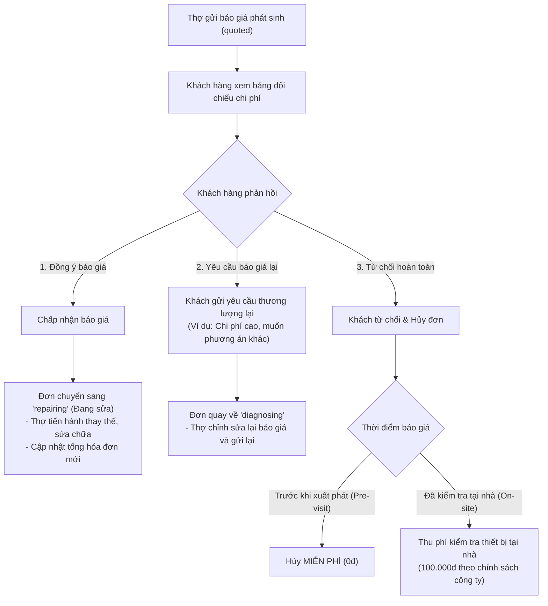
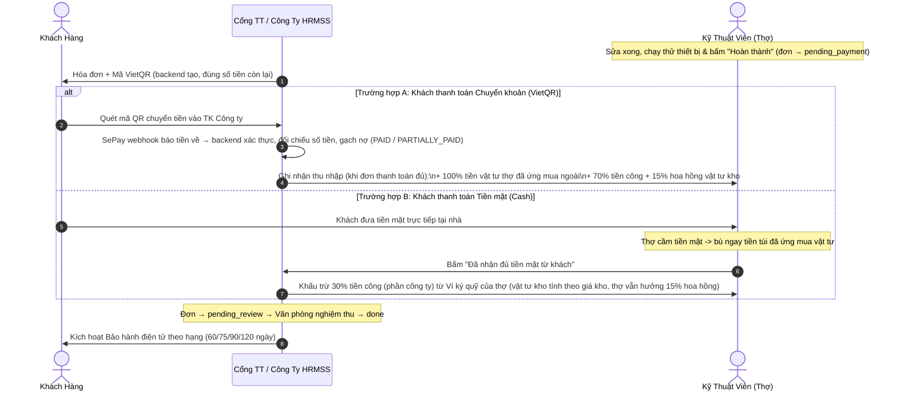

# TÀI LIỆU QUY TRÌNH BÁO GIÁ PHÁT SINH & XỬ LÝ DÒNG TIỀN (HRMSS)
> **Tài liệu đặc tả nghiệp vụ tài chính & báo giá dành cho Đồ án Tốt nghiệp / Phía Backend & Mobile App**  
> *Hệ thống Dịch vụ Sửa chữa & Bảo trì Điện gia dụng HRMSS (Home Repair Management & Service System) — app khách/thợ: "Thợ Minh Đức"*

> [!NOTE]
> **Ghi chú thống nhất (cập nhật 11/2026)**
> - **Chia tiền (một quy tắc duy nhất):** thợ hưởng **70% tiền công** (cả công gốc và công phát sinh) + **15% hoa hồng trên vật tư lấy từ kho công ty**; **vật tư mua ngoài hoàn 100%**. Khi khách trả **tiền mặt**, thợ giữ tiền và công ty **khấu trừ 30% tiền công** (phần của công ty) từ **ví ký quỹ** của thợ. Các con số cũ (80–90%, 75–80%, 20–25%) đã bỏ.
> - **Hoàn ứng vật tư** khi đơn được **thanh toán đủ**. Luồng: hoàn thành → thanh toán (VietQR/tiền mặt) → Văn phòng nghiệm thu → `done` (app: `pending_payment`/`partially_paid` → `pending_review` → `done`).
> - **Bảo hành theo hạng**: 60 / 75 / 90 / 120 ngày (Thành viên / Bạc / Vàng / Kim cương), tối thiểu 60 ngày.
> - **VietQR**: mã do backend tạo (ảnh `img.vietqr.io`), tiền về được **SePay webhook** báo cho backend; app kiểm tra hoá đơn mỗi 5 giây. Số tài khoản trong tài liệu là **ví dụ minh hoạ**.
> - **Ví thợ / rút tiền trên app** là **hướng phát triển**: backend hiện chưa có bảng ví; văn phòng đối soát và chi trả ngoài app.
> - Mã đơn tiền tố `HRM` (ví dụ `HRM261108-03`); công ty: *CTY CP CÔNG NGHỆ & DỊCH VỤ HRMSS*.

---

## 1. TỔNG QUAN MÔ HÌNH VẬN HÀNH
Khác với các ứng dụng gọi xe/giao hàng tự do kiểu Grab/Gojek (thợ tự do, giá linh hoạt, không cam kết chất lượng), HRMSS được xây dựng theo mô hình **Doanh nghiệp quản lý tập trung (Managed Service Marketplace / In-house Technical Enterprise)**:
- **Công ty đứng ra bảo lãnh chất lượng:** Cam kết bảo hành điện tử theo hạng thành viên 60 / 75 / 90 / 120 ngày (tối thiểu 60 ngày) cho mọi đơn hoàn tất.
- **Minh bạch chi phí 100%:** Mọi khoản chi phí (tiền công cố định, linh kiện niêm yết, chi phí phát sinh) đều phải thông qua sự phê duyệt của khách hàng trên ứng dụng.
- **Dòng tiền khép kín qua tài khoản công ty (Escrow Model):** Bảo vệ quyền lợi người tiêu dùng và đảm bảo thu nhập minh bạch cho kỹ thuật viên (thợ).

---

## 2. QUY TRÌNH BÁO GIÁ & CHI PHÍ PHÁT SINH

### 2.1. Phân loại chi phí phát sinh
Trong quá trình thợ đến kiểm tra tại nhà, có thể xuất hiện 2 dạng chi phí phát sinh:
1. **🛠 Công phát sinh (Labor):**
   - *Ví dụ:* Hàn vá lỗ mọt ống đồng dàn lạnh, gia cố bas treo quạt gió, cắt tỉa đi lại đường dây điện âm tường...
   - *Tính chất:* Không tốn chi phí mua sắm vật tư, phát sinh từ thời gian và kỹ thuật tay nghề của thợ.
   - *Tỷ lệ chi trả:* Thợ hưởng **70%** số tiền công này (cùng tỷ lệ với tiền công gốc), 30% thuộc về công ty.
2. **🔩 Vật tư / Linh kiện ngoài (Parts / Materials):**
   - *Ví dụ:* 2m ống đồng Thái Lan phi 10, tụ quạt dàn nóng 3.5uF, aptomat phụ Panasonic 20A...
   - *Tính chất:* Thợ mua tại đại lý ngoài hoặc lấy linh kiện phát sinh. Thợ có thể ứng tiền túi mua nếu kho xe không có sẵn.
   - *Tỷ lệ chi trả:* Vật tư **mua ngoài** (thợ ứng tiền, có ảnh hoá đơn) được hoàn **100%** khi đơn được thanh toán đủ. Vật tư **lấy từ kho công ty**: thợ hưởng **15% hoa hồng** trên giá trị vật tư.

### 2.2. Các bước lập báo giá phía Thợ (`TechJobScreen`)
1. **Kiểm tra thiết bị & Chụp ảnh minh chứng:**
   - Thợ tháo máy, xác định linh kiện hư hỏng.
   - Chụp ảnh tình trạng trước khi sửa (`stage: diagnosis`) lưu vào mục `Evidence`.
2. **Nhập chi phí phát sinh:**
   - Bấm nút `[ ＋ Nhập phí phát sinh ]`.
   - Chọn loại: **🛠 Công phát sinh** hoặc **🔩 Vật tư ngoài**.
   - Nhập nội dung mô tả (ví dụ: *Hàn nối ống đồng bị nứt lổ mọt*).
   - Nhập số tiền phát sinh (VNĐ).
3. **Đối soát & Gửi báo giá:**
   - Hệ thống tự động tính toán tổng mới: `qTotal = lines.reduce(...)`.
   - Tính chênh lệch: `diff = qTotal - booked`.
   - Nếu `diff > 0`: Hiển thị cảnh báo màu cam: *"Phát sinh +...đ → khách cần duyệt báo giá trên app trước khi làm"*.
   - Thợ bấm **`Gửi báo giá cho khách`**. Trạng thái đơn chuyển thành `quoted`.

---

## 3. PHÍA KHÁCH HÀNG: DUYỆT BÁO GIÁ VÀ XỬ LÝ TỪ CHỐI

Khi thợ gửi báo giá, trên màn hình khách hàng (`OrderScreen`) sẽ hiển thị thẻ **"Báo giá từ thợ [Tên thợ]"** kèm đối chiếu chi phí ban đầu, chi phí phát sinh và tổng thanh toán mới.

---

## 4. XỬ LÝ DÒNG TIỀN KHI HOÀN THÀNH (NGHIỆM THU)

> **NGUYÊN TẮC CỐT LÕI:**  
> Khách hàng **CHUYỂN KHOẢN VÀO TÀI KHOẢN CÔNG TY (APP)** thông qua mã VietQR động, **KHÔNG** chuyển khoản vào tài khoản cá nhân của thợ.

### 4.1. Thông tin Tài khoản VietQR Công ty hiển thị trên hóa đơn:
> Mã QR và thông tin tài khoản do **backend tạo** (ảnh `img.vietqr.io`), app chỉ hiển thị. Các giá trị dưới đây là **ví dụ minh hoạ**.
- **Đơn vị thụ hưởng:** `CTY CP CÔNG NGHỆ & DỊCH VỤ HRMSS`
- **Ngân hàng:** `MBBank (Ngân hàng TMCP Quân Đội)`
- **Số tài khoản:** `0908 888 999` *(ví dụ minh hoạ)*
- **Số tiền:** đúng số tiền **còn phải trả** của hoá đơn (chuyển thiếu → backend tạo mã mới cho phần còn lại).
- **Nội dung chuyển khoản:** do backend sinh, gắn với đơn (dạng `HRMSS<số>`); mã đơn hiển thị cho khách dạng `HRM261108-01`.
- **Xác nhận:** SePay gọi webhook báo tiền về → backend đối chiếu số tiền, gạch nợ; app kiểm tra hoá đơn mỗi 5 giây.
- **Cam kết:** Phiếu Bảo Hành Điện Tử theo hạng (60 / 75 / 90 / 120 ngày) sau khi đơn hoàn tất.

### 4.2. Lưu đồ dòng tiền khép kín:

> Ví dụ: tiền công 300.000đ, vật tư kho 200.000đ, vật tư mua ngoài 150.000đ → thợ hưởng 210.000đ (70% công) + 30.000đ (15% vật tư kho) + hoàn 150.000đ. Nếu khách trả tiền mặt 650.000đ cho thợ, công ty khấu trừ từ ví ký quỹ: 90.000đ (30% công) + 170.000đ (vật tư kho sau hoa hồng) = 260.000đ.

---

## 5. CƠ CHẾ HOÀN TIỀN ỨNG MUA VẬT TƯ CHO THỢ

1. **Số hóa minh chứng:**
   - Khi thợ mua vật tư ngoài, thợ chụp ảnh phiếu mua hàng/hóa đơn bán lẻ tải lên app.
   - Thợ không cần giữ hóa đơn giấy mang về trụ sở nộp cho phòng kế toán.
2. **Hoàn ứng khi đơn được thanh toán đủ:**
   - Khi hoá đơn chuyển sang đã thanh toán đủ, hệ thống nhận diện các dòng vật tư mua ngoài (`isCustom: true` và `type: 'part'`) và ghi nhận hoàn 100% giá trị cho thợ trong kỳ đối soát.
3. **Chi trả (Payout):**
   - **Hiện tại:** văn phòng đối soát và chi trả ngoài app (backend chưa có bảng ví).
   - **Hướng phát triển:** Ví thu nhập trên app, thợ bấm **`Rút tiền`** về tài khoản ngân hàng cá nhân.

---

## 6. BỘ CÂU HỎI & TRẢ LỜI MẪU CHO BUỔI BẢO VỆ ĐỒ ÁN

### Câu 1: Tại sao không để khách chuyển khoản thẳng cho thợ cho nhanh?
> **Trả lời:** Nếu khách chuyển khoản thẳng cho thợ, công ty mất quyền kiểm soát dòng tiền, khó thu phần của công ty và thợ có thể thông đồng với khách để làm đơn ngoài. Khách cũng mất quyền lợi bảo hành nếu thợ nghỉ việc. Chuyển khoản về tài khoản Công ty qua VietQR có nội dung gắn với đơn giúp công ty giữ vai trò bảo lãnh chất lượng, kích hoạt bảo hành điện tử theo hạng (tối thiểu 60 ngày) và chia thu nhập cho thợ minh bạch (70% công + 15% hoa hồng vật tư kho + hoàn 100% vật tư mua ngoài).

### Câu 2: Nếu thợ đến nơi kiểm tra xong nhưng khách không đồng ý báo giá thì ai chịu chi phí đi lại của thợ?
> **Trả lời:** Hệ thống HRMSS có chính sách phân tầng:
> - Trước khi thợ tới: khách huỷ miễn phí khi đơn đang chờ nhận/đã nhận và còn ≥ 60 phút trước giờ hẹn.
> - Nếu thợ đã đến tận nhà, check-in GPS và tháo máy chẩn đoán mà khách không đồng ý phương án sửa: khách thanh toán **Phí kiểm tra tại nhà** (quy định khi đặt). Khoản này bù chi phí đi lại và công kiểm tra của thợ.

### Câu 3: Thợ có sợ bị công ty giữ tiền linh kiện lâu không?
> **Trả lời:** Không. Vật tư mua ngoài có ảnh hoá đơn và đã được khách duyệt sẽ được hoàn 100% **khi đơn được thanh toán đủ**, không cần chờ thủ tục giấy tờ cuối tháng. Hiện văn phòng chi trả theo kỳ đối soát; hoàn tự động vào ví và rút tiền trên app là hướng phát triển.

