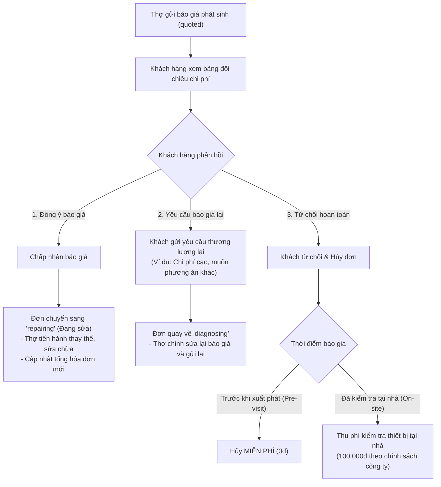
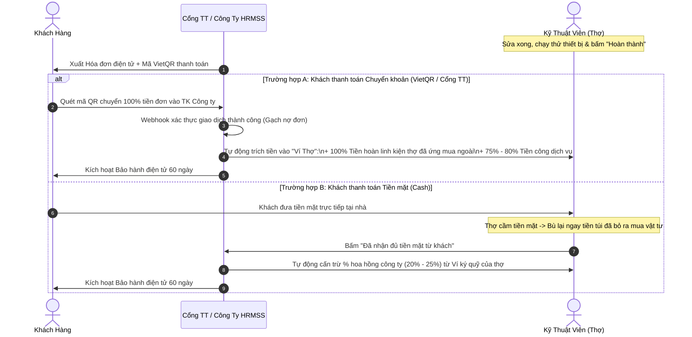

# TÀI LIỆU QUY TRÌNH BÁO GIÁ PHÁT SINH & XỬ LÝ DÒNG TIỀN (HRMSS)
> **Tài liệu đặc tả nghiệp vụ tài chính & báo giá dành cho Đồ án Tốt nghiệp / Phía Backend & Mobile App**  
> *Hệ thống Dịch vụ Sửa chữa & Bảo trì Điện gia dụng HRMSS (Home Repair Management & Service System)*

---

## 1. TỔNG QUAN MÔ HÌNH VẬN HÀNH
Khác với các ứng dụng gọi xe/giao hàng tự do kiểu Grab/Gojek (thợ tự do, giá linh hoạt, không cam kết chất lượng), HRMSS được xây dựng theo mô hình **Doanh nghiệp quản lý tập trung (Managed Service Marketplace / In-house Technical Enterprise)**:
- **Công ty đứng ra bảo lãnh chất lượng:** Cam kết bảo hành điện tử từ 30 đến 90 ngày cho mọi thiết bị.
- **Minh bạch chi phí 100%:** Mọi khoản chi phí (tiền công cố định, linh kiện niêm yết, chi phí phát sinh) đều phải thông qua sự phê duyệt của khách hàng trên ứng dụng.
- **Dòng tiền khép kín qua tài khoản công ty (Escrow Model):** Bảo vệ quyền lợi người tiêu dùng và đảm bảo thu nhập minh bạch cho kỹ thuật viên (thợ).

---

## 2. QUY TRÌNH BÁO GIÁ & CHI PHÍ PHÁT SINH

### 2.1. Phân loại chi phí phát sinh
Trong quá trình thợ đến kiểm tra tại nhà, có thể xuất hiện 2 dạng chi phí phát sinh:
1. **🛠 Công phát sinh (Labor):**
   - *Ví dụ:* Hàn vá lỗ mọt ống đồng dàn lạnh, gia cố bas treo quạt gió, cắt tỉa đi lại đường dây điện âm tường...
   - *Tính chất:* Không tốn chi phí mua sắm vật tư, phát sinh từ thời gian và kỹ thuật tay nghề của thợ.
   - *Tỷ lệ chi trả:* 80% - 90% số tiền công này thuộc về thu nhập của thợ.
2. **🔩 Vật tư / Linh kiện ngoài (Parts / Materials):**
   - *Ví dụ:* 2m ống đồng Thái Lan phi 10, tụ quạt dàn nóng 3.5uF, aptomat phụ Panasonic 20A...
   - *Tính chất:* Thợ mua tại đại lý ngoài hoặc lấy linh kiện phát sinh. Thợ có thể ứng tiền túi mua nếu kho xe không có sẵn.
   - *Tỷ lệ chi trả:* Hoàn trả 100% giá trị vật tư vào Ví Thợ ngay khi khách nghiệm thu đơn.

### 2.2. Các bước lập báo giá phía Thợ (`TechJobScreen`)
1. **Kiểm tra thiết bị & Chụp ảnh minh chứng:**
   - Thợ tháo máy, xác định linh kiện hư hỏng.
   - Chụp ảnh tình trạng trước khi sửa (`stage: diagnosis`) lưu vào mục `Evidence`.
2. **Nhập chi phí phát sinh:**
   - Bấm nút `[ ＋ Nhập phí phát sinh ]`.
   - Chọn loại: **🛠 Công phát sinh** hoặc **🔩 Vật tư ngoài**.
   - Nhập nội dung mô tả (ví dụ: *Hàn nối ống đồng bị nứt lổ mọt*).
   - Nhập số tiền phát sinh (VNĐ).
3. **Đối soát & Gửi báo giá:**
   - Hệ thống tự động tính toán tổng mới: `qTotal = lines.reduce(...)`.
   - Tính chênh lệch: `diff = qTotal - booked`.
   - Nếu `diff > 0`: Hiển thị cảnh báo màu cam: *"Phát sinh +...đ → khách cần duyệt báo giá trên app trước khi làm"*.
   - Thợ bấm **`Gửi báo giá cho khách`**. Trạng thái đơn chuyển thành `quoted`.

---

## 3. PHÍA KHÁCH HÀNG: DUYỆT BÁO GIÁ VÀ XỬ LÝ TỪ CHỐI

Khi thợ gửi báo giá, trên màn hình khách hàng (`OrderScreen`) sẽ hiển thị thẻ **"Báo giá từ thợ [Tên thợ]"** kèm đối chiếu chi phí ban đầu, chi phí phát sinh và tổng thanh toán mới.

---

## 4. XỬ LÝ DÒNG TIỀN KHI HOÀN THÀNH (NGHIỆM THU)

> **NGUYÊN TẮC CỐT LÕI:**  
> Khách hàng **CHUYỂN KHOẢN VÀO TÀI KHOẢN CÔNG TY (APP)** thông qua mã VietQR động, **KHÔNG** chuyển khoản vào tài khoản cá nhân của thợ.

### 4.1. Thông tin Tài khoản VietQR Công ty hiển thị trên hóa đơn:
- **Đơn vị thụ hưởng:** `CTY CP CÔNG NGHỆ & DỊCH VỤ HRMSS`
- **Ngân hàng:** `MBBank (Ngân hàng TMCP Quân Đội)`
- **Số tài khoản:** `0908 888 999`
- **Cú pháp chuyển khoản:** `[Mã đơn hàng, ví dụ: HRM261108-01]`
- **Cam kết:** Kích hoạt tự động **Phiếu Bảo Hành Điện Tử 60 ngày**.

### 4.2. Lưu đồ dòng tiền khép kín:

---

## 5. CƠ CHẾ HOÀN TIỀN ỨNG MUA VẬT TƯ CHO THỢ

1. **Số hóa minh chứng bằng chứng:**
   - Khi thợ mua vật tư ngoài, thợ chỉ cần chụp ảnh phiếu mua hàng/hóa đơn bán lẻ tải lên app.
   - Thợ không cần giữ hóa đơn giấy mang về trụ sở nộp cho phòng kế toán.
2. **Hoàn tiền tức thì (Instant Reimbursement):**
   - Khi đơn hàng được thanh toán, hệ thống tự động nhận diện các dòng vật tư phát sinh (`isCustom: true` và `type: 'part'`) và giải ngân 100% giá trị vào **Ví thợ trên App**.
3. **Rút tiền về tài khoản ngân hàng (Payout):**
   - Thợ vào tab **Tài khoản** $\rightarrow$ **Ví thu nhập** $\rightarrow$ Bấm **`Rút tiền`** về tài khoản ngân hàng cá nhân của mình bất kỳ lúc nào.

---

## 6. BỘ CÂU HỎI & TRẢ LỜI MẪU CHO BUỔI BẢO VỆ ĐỒ ÁN

### Câu 1: Tại sao không để khách chuyển khoản thẳng cho thợ cho nhanh?
> **Trả lời:** Nếu khách chuyển khoản thẳng cho thợ, công ty sẽ mất quyền kiểm soát dòng tiền, khó thu hoa hồng và thợ có thể thông đồng với khách để hủy đơn ngoài. Đặc biệt, khách hàng sẽ mất quyền lợi bảo hành nếu thợ nghỉ việc. Bằng cách chuyển khoản về tài khoản Công ty qua VietQR có mã đơn hàng, công ty giữ vai trò bảo lãnh chất lượng, kích hoạt bảo hành điện tử 60 ngày và phân chia thu nhập cho thợ tự động, minh bạch.

### Câu 2: Nếu thợ đến nơi kiểm tra xong nhưng khách không đồng ý báo giá thì ai chịu chi phí đi lại của thợ?
> **Trả lời:** Hệ thống HRMSS có chính sách phân tầng rất rõ ràng:
> - Nếu báo giá sơ bộ qua app trước khi thợ xuất phát: Khách hủy hoàn toàn miễn phí (0đ).
> - Nếu thợ đã đến tận nhà, check-in GPS và tháo máy chẩn đoán mà khách không đồng ý phương án sửa: Khách hàng sẽ thanh toán khoản **Phí kiểm tra tại nhà 100.000đ**. Khoản này được trả cho thợ để bù đắp chi phí xăng xe và công sức đo đạc chuyên môn.

### Câu 3: Thợ có sợ bị công ty giữ tiền linh kiện lâu không?
> **Trả lời:** Không, vì hệ thống áp dụng cơ chế **Hoàn ứng tự động qua Ví (Instant Reimbursement)**. Ngay khi khách nghiệm thu đơn, tiền mua linh kiện được hoàn trả 100% ngay lập tức vào Ví trên App của thợ, thợ có thể rút về tài khoản ngân hàng của mình mà không cần chờ thủ tục giấy tờ cuối tháng.
